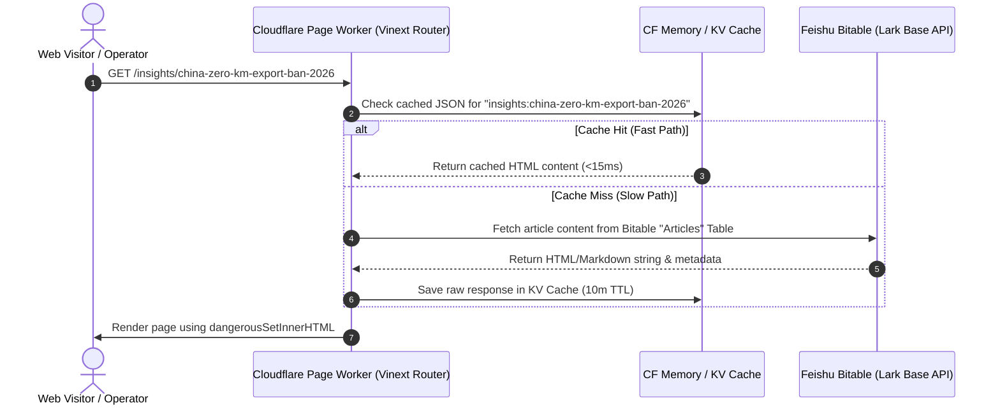

# Design Spec: Feishu Bitable Dynamic Website Refactoring (Full-Scale)

This document defines the system design to completely migrate the website's static catalogs, articles, and training lessons into Feishu Bitable, removing all static code files under `app/products/`, `app/insights/`, and `app/academy/`, while preserving all original frontend URLs, layout structures, and styles.

## 1. Background & Goals

The Youguard codebase contains nearly 80 static directories repeating page layout wrappers and static HTML string constants:
* **Vehicles**: ~40 folders defining static specifications and batch pricing configurations.
* **Insights**: ~30 folders defining static policy reports and market analysis blog posts.
* **Academy**: ~15 folders defining dealer training lessons and resource downloads.

By consolidating all content into Feishu Bitable as the single dynamic data foundation:
1. **Zero-Code Operations**: Non-technical staff can write markdown articles, upload PDF checklists, and update vehicle specs directly inside the Feishu interface without code releases.
2. **Stateless Edge Delivery**: By caching Bitable reads on Cloudflare Pages/Workers, we guarantee sub-20ms page load speeds and stay well below Feishu's **100 requests/minute** free tenant limits.
3. **Exact Visual Preservation**: All layout rendering, styles, tailwind classes, carousels, and original URLs are preserved by shifting to a unified dynamic routing model.

---

## 2. Dynamic Architecture & Data Flow

Below is the Mermaid sequence diagram showing the unified edge delivery flow:



---

## 3. Feishu Bitable Schema Design

To support all dynamic features, the Feishu Base is expanded with 3 new tables:

### 3.1 `Articles` Table (Insights & Policy reports)
* `slug` (Text): Unique URL slug (e.g. `china-zero-km-export-ban-2026`)
* `title` (Text): Article title
* `category` (Single Select): `Market Analysis` | `Policy & Tariffs` | `Sourcing Intelligence` | `Operator Hub` | `Product Watch` | `Pricing & Trade`
* `overview` (Text): Multi-line introduction paragraph
* `cover_image` (Text/Attachment): Cover image file or URL path
* `publish_date` (Date): Publication date (e.g. `2026-06-20`)
* `read_time` (Text): Reading time estimation (e.g. `6 min`)
* `content` (Long Text): HTML body content string
* `status` (Single Select): `Published` | `Draft`

### 3.2 `Academy Lessons` Table (Training Curriculum)
* `slug` (Text): Unique URL slug (e.g. `ev-objections-african-dealers`)
* `title` (Text): Lesson title
* `category` (Single Select): `fundamentals` | `playbook` | `workshop`
* `tag` (Text): Lesson badge label (e.g. `Battery Tech`, `Diagnostics`)
* `description` (Text): Multi-line introduction
* `cover_image` (Text/Attachment): Lesson cover image path
* `content` (Long Text): HTML body content string
* `status` (Single Select): `Published` | `Draft`

### 3.3 `Academy Vault` Table (Tools & PDF Downloads)
* `title` (Text): Resource name (e.g. `The 50-Point Factory PDI Checklist`)
* `type` (Single Select): `Excel Model` | `PDF Guide` | `Video Tutorial`
* `size` (Text): File size display (e.g. `2.4 MB`)
* `download_link` (Text/Attachment): Direct attachment download or URL path
* `description` (Text): Resource explanation paragraph

---

## 4. Node.js Data Migration Script

An automated Node script `scripts/import-frontend-to-feishu.mjs` will be written to extract existing content from the project and write to Feishu Bitable:

1. **Vehicles**: Reads `data.ts` and extracts `specsLeft`, `specsRight`, `trimData`, `batchLevels` from each model directory.
2. **Insights**: Reads the array in `app/insights/page.tsx`, extracts the metadata, then reads the `content` string inside each subfolder's `page.tsx`.
3. **Academy**: Parses `app/academy/page.tsx` for metadata categories, then reads the `content` string and `CAT_ARTICLES` from each lesson subfolder.
4. **Feishu Upload**: Authenticates via `tenant_access_token` and inserts records cleanly into Feishu, matching their categories and slug keys.

---

## 5. Cloudflare Worker APIs

We will implement the following endpoints in `worker/portal.ts`:
* `GET /api/portal/public/products/:slug` - Returns vehicle specs, trims, images.
* `GET /api/portal/public/insights` - Returns all published articles (sorted and filtered).
* `GET /api/portal/public/insights/:slug` - Returns full article body HTML.
* `GET /api/portal/public/academy` - Returns lessons (fundamentals, playbook, workshop) and vault items.
* `GET /api/portal/public/academy/:category/:slug` - Returns full lesson body HTML.

---

## 6. Frontend Dynamic Routing Setup

We will create dynamic routing controllers under `app/`:

### 6.1 Products Dynamic Controller
* Path: [app/products/[category]/[slug]/page.tsx](file:///Users/a12/projects/youguard/app/products/%5Bcategory%5D/%5Bslug%5D/page.tsx)
* Renders `<VehicleDetail data={data} />` using dynamically fetched vehicle specifications.

### 6.2 Insights Dynamic Controller
* Path: [app/insights/[slug]/page.tsx](file:///Users/a12/projects/youguard/app/insights/%5Bslug%5D/page.tsx)
* Renders using exactly the same header, cover-image aspect ratios, and sidebar widgets as before:
```tsx
<article className="article-body max-w-3xl" dangerouslySetInnerHTML={{ __html: article.content }} />
```

### 6.3 Academy Dynamic Controller
* Path: [app/academy/[category]/[slug]/page.tsx](file:///Users/a12/projects/youguard/app/academy/%5Bcategory%5D/%5Bslug%5D/page.tsx)
* Renders the lesson HTML dynamically and generates the category sidebar navigation from the fetched API model.

### 6.4 Cleanups
All individual vehicle, insight, and academy subfolders will be deleted after verification, leaving the codebase clean, modular, and dynamic.
