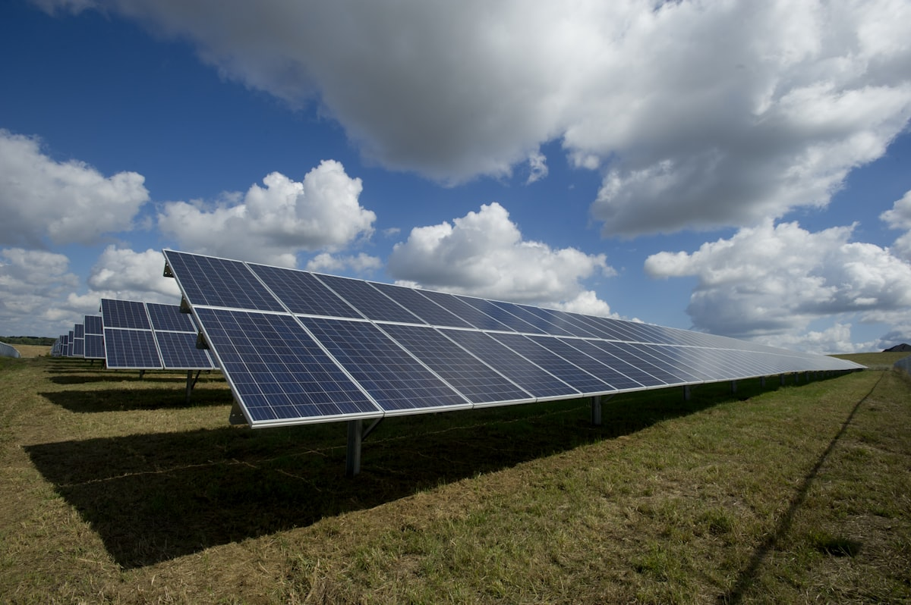

# Africa E-Mobility Report 2025: Key Findings Every Dealer Needs to Read

**Category:** Market Analysis  
**Date:** October 15, 2025  
**Read Time:** 8 min  
**Tag:** Africa E-Mobility · Market Report · AEA 2025 · Fleet Data

---

*Africa's energy transition and its EV adoption story are inseparable — the Africa E-Mobility Alliance's 2025 report frames electric mobility within the continent's broader push to leapfrog fossil fuel infrastructure.*

---

## Overview

Published in September 2025, the **Africa E-Mobility Report 2025** by the Africa E-Mobility Alliance (AEA) is the most comprehensive continent-specific analysis of EV market development currently available. Unlike global reports that treat Africa as a footnote, the AEA report goes country-by-country, segment-by-segment, and policy-by-policy across the continent's most active EV markets.

This analysis draws on the report's key findings and translates them into actionable intelligence for dealers and fleet operators.

---

## The Continent-Wide Picture

The report's headline findings confirm and expand on IEA data, adding Africa-specific depth:

- **EV sales more than doubled in 2024** versus 2023, driven primarily by Morocco and Egypt
- **Sales penetration remains below 1%** continent-wide — the lowest of any region globally
- **Three- and two-wheelers** are the fastest-growing EV segment by unit volume in East and West Africa, though outside the scope of this analysis for commercial fleet dealers
- **Government fleet electrification** is the primary demand driver in Sub-Saharan Africa, with commercial consumer purchases lagging behind by 18–24 months

The gap between the headline growth rate (doubling) and the absolute penetration (under 1%) is the defining tension of the African EV market — and the source of both the opportunity and the risk for early-stage dealers.

---

*The AEA report covers over 30 African countries with specific data on EV registrations, charging infrastructure, policy frameworks, and OEM presence — the most granular Africa-specific dataset currently published.*

---

## Country-by-Country Highlights

### Kenya
The report identifies Kenya as the most advanced Sub-Saharan EV market by policy maturity. The combination of 0% import duty, an active ride-hailing sector, and Nairobi's urban density create the strongest commercial fleet EV economics on the continent. The report notes that Kenya's EV fleet is growing primarily through commercial channels — taxi operators, logistics companies, and government fleet managers — rather than retail consumer purchases.

### South Africa
South Africa has the continent's largest existing passenger vehicle market (approximately 500,000 new vehicles per year) and the most sophisticated dealer infrastructure. BYD's rapid network expansion is the dominant story, with the report noting that South Africa's Q1 2025 NEV share of 2.4% already exceeds the continental average by a factor of three. However, South Africa's high import duty on EVs (25%) remains the primary constraint on cost competitiveness.

### Ethiopia
The report highlights Ethiopia's unique position as the only country globally with an active ICE import ban, while also noting the policy volatility that has characterised its EV incentive framework (VAT reinstatement, customs duty increase). Ethiopia's EV fleet tripled between 2023 and 2025, but primarily in the commercial taxi and ride-hailing sector — consumer purchases remain rare.

### Nigeria
Noted as a market with significant structural potential (largest economy in Africa, population over 200 million, high urban density in Lagos and Abuja) but limited current EV activity. The 2024 VAT Modification Order is identified as a meaningful policy signal, though implementation challenges and infrastructure constraints are flagged as near-term barriers.

### Rwanda
Flagged as an interesting outlier — a small market with a comprehensive EV exemption framework (full tax exemption on EVs) and a government that has used EV deployment as a deliberate urban image strategy. Rwanda's EV fleet is disproportionately large relative to its economy and is primarily composed of two- and three-wheelers alongside a small passenger car segment.

---

*The AEA report notes that Africa's variable infrastructure — particularly electricity grid reliability and road quality — is the primary physical constraint on EV adoption, distinct from policy or pricing factors.*

---

## The Infrastructure Reality Check

The report is unusually candid about the barriers that policy analysis alone often understates:

**Electricity grid reliability** is the first-order problem in most Sub-Saharan markets. An EV that cannot be reliably charged is not a viable commercial asset. The report notes that dealers who provide — or facilitate access to — solar charging solutions are significantly more successful in penetrating fleet buyer accounts than those selling vehicles alone.

**Road quality and vehicle durability** is the second constraint. Chinese EVs designed for Chinese road conditions perform differently on African roads with higher dust, more unpaved surfaces, and fewer maintained charging facilities. The report recommends that dealers specifically evaluate suspension systems, dust ingress protection ratings, and ground clearance when selecting models for Sub-Saharan deployment.

**Spare parts supply chains** are the third identified barrier. The AEA report found that after-sales service quality — specifically parts availability within 30 days — is the single most important factor in commercial fleet buyer decision-making, ahead of purchase price. Dealers with established parts supply chains are capturing fleet contracts that dealers with better pricing but weaker service cannot close.

## The Strategic Summary

The Africa E-Mobility Report 2025 paints a picture of a market that is unambiguously real and growing — but one where execution quality matters more than market entry timing. The dealers who will build durable businesses in African EV markets are those who solve the after-sales equation, not just the procurement equation.

The report is available as a free PDF download from the Africa E-Mobility Alliance website at africaema.org — required reading for any dealer building a serious Africa EV strategy.

---

## Sources

- Africa E-Mobility Alliance — *Africa E-Mobility Report 2025* (September 2025), available at africaema.org
- IEA — *Global EV Outlook 2025*
- EV24.Africa — multiple country-specific policy guides (2025–2026)

---

*Published by Evexport Intelligence Desk · October 2025*
