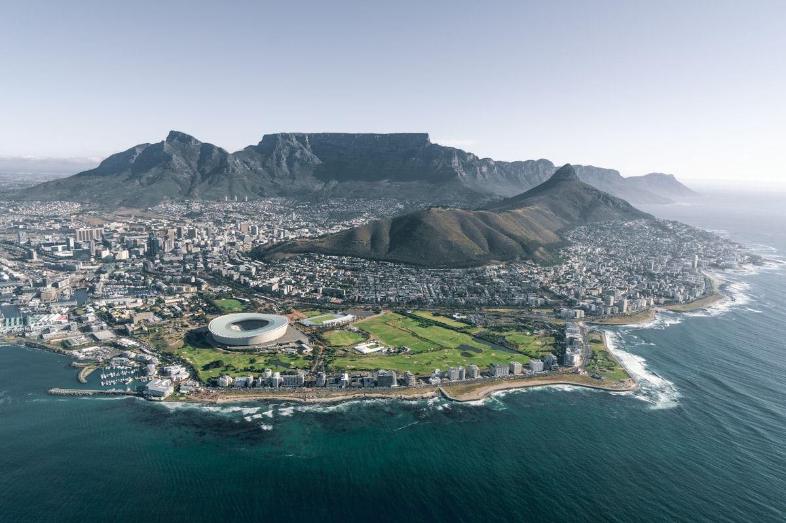
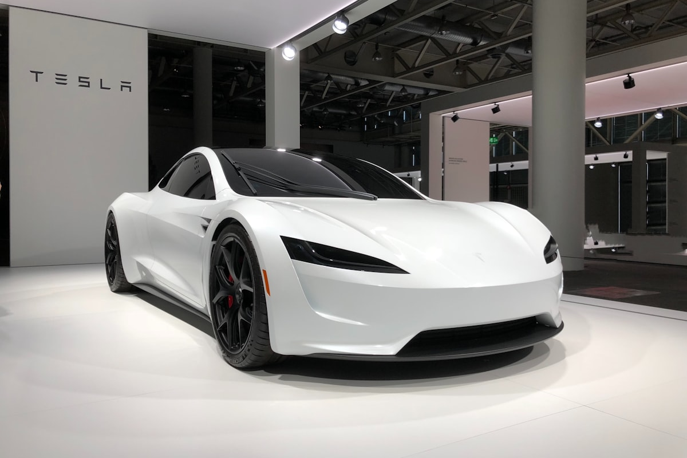

# BYD Is Tripling Its South Africa Dealership Network. What It Means for the Continent.

**Category:** Market Analysis  
**Date:** June 20, 2026  
**Read Time:** 6 min  
**Tag:** BYD · South Africa · Dealer Network · Chinese OEM Expansion

---

*South Africa — the continent's most advanced automotive market by infrastructure and consumer sophistication — is BYD's chosen anchor for its Africa expansion strategy.*

---

## Overview

In June 2025, BYD confirmed it would expand its South Africa dealer network from approximately 13 locations to **60–70 dealerships by the end of 2026**. That is a more than five-fold increase in 18 months, in a market where BYD only launched its first model (the Atto 3) in 2023.

The announcement is not simply a South Africa story. South Africa is the proving ground for BYD's Africa continental strategy — the market where it is stress-testing its dealer model, its after-sales infrastructure, its financing partnerships, and its brand positioning. What succeeds in South Africa typically rolls north to East and West Africa within 18–24 months.

---

## The Numbers Behind the Expansion

BYD's South Africa trajectory illustrates the pace at which the world's largest EV manufacturer can move when it commits to a market:

| Timeline | BYD SA Dealer Count | Notes |
|----------|---------------------|-------|
| 2023 | 6 | Atto 3 launch year |
| Early 2025 | 13 | Confirmed active dealers |
| End of 2025 target | ~20 | Initial expansion target |
| Q1 2026 | ~35 | Revised target, met ahead of schedule |
| End of 2026 target | **60–70** | Current confirmed target |

South Africa's new energy vehicle registrations reached **3,487 units in Q1 2025** alone — a 2.4% market share, up from 1.4% in 2023. BYD is not expanding into an abstract future market; it is responding to documented demand growth.

---

*BYD's South Africa expansion follows the same playbook used in Europe and Southeast Asia: rapid dealer network build-out, standardised showroom design, and a multi-model product lineup covering entry to premium segments.*

---

## The Product Lineup in South Africa

BYD currently offers six models in South Africa, covering a broader range than most Chinese manufacturers have launched on the continent:

- **Seagull** — entry-level urban EV, positioned for commercial and ride-hailing use
- **Dolphin** — compact hatchback, mid-range pricing
- **Atto 3** — compact SUV, the launch model and highest volume seller
- **Seal** — sports sedan, premium positioning
- **Sealion 7** — large SUV
- **Shark 6** — plug-in hybrid pickup truck (relevant for markets where charging infrastructure is limited)

The breadth of this lineup is strategically deliberate. BYD is not targeting a single buyer segment — it is attempting to establish category dominance across commercial, private, and mixed-use applications simultaneously.

---

*BYD's Africa-facing lineup includes both full BEV and plug-in hybrid (PHEV) options — a pragmatic acknowledgement that charging infrastructure remains uneven across the continent.*

---

## Chery: The Second Major Mover

BYD is not alone. Chery — China's largest private automotive group by export volume — announced the rollout of eight hybrid and plug-in hybrid models in South Africa in 2025–2026, with a commitment to introduce its full EV range (iCar brand) and the Lepas brand in the near future.

Chery's advantage is an existing ICE dealer network in multiple African markets. Where BYD must build dealer relationships from scratch, Chery can leverage established importers who already understand local compliance, financing, and after-sales requirements and are transitioning their existing customer base from ICE to EV.

## What This Means Beyond South Africa

The South Africa expansion blueprint is significant for dealers in Kenya, Nigeria, Ethiopia, and other Sub-Saharan markets for three reasons:

**1. After-sales parts infrastructure is being built at continental scale.** When BYD and Chery invest in regional distribution centres and training programmes in South Africa, those investments eventually serve the broader continent. Parts that reach Johannesburg in three weeks reach Nairobi in five — a meaningful improvement over the six-to-twelve week supply chain that many African EV importers currently manage.

**2. Consumer awareness is a trailing indicator.** The intense marketing investment Chinese OEMs are making in South Africa is building brand recognition that, in time, will make it easier to sell the same vehicles in smaller markets. A Kenyan buyer who has seen BYD advertising during the Rugby World Cup or at a Johannesburg auto show is a warmer prospect than one encountering the brand for the first time.

**3. The competitive window is closing, not opening.** Dealers in East and West Africa who establish BYD or Chery partnerships now — before the brands have saturated those markets with direct distribution relationships — are in a stronger negotiating position than those who wait until the OEMs have built their own regional offices.

---

## Sources

- CnEVPost — *"BYD to nearly triple dealer network in South Africa by 2026"* (June 2025)
- Times Live — *"BYD accelerates SA expansion with more dealerships planned in 2026"* (December 2025)
- CNBC Africa — *"China's BYD to nearly triple South Africa dealers' network"* (2025)
- Ecofin Agency — *"BYD Accelerates Expansion in South Africa as EV Market Grows"*
- Asia Financial — *"Chinese EV-Makers Eyeing South Africa Amid Global Trade Rows"*

---

*Published by Evexport Intelligence Desk · June 2026*
