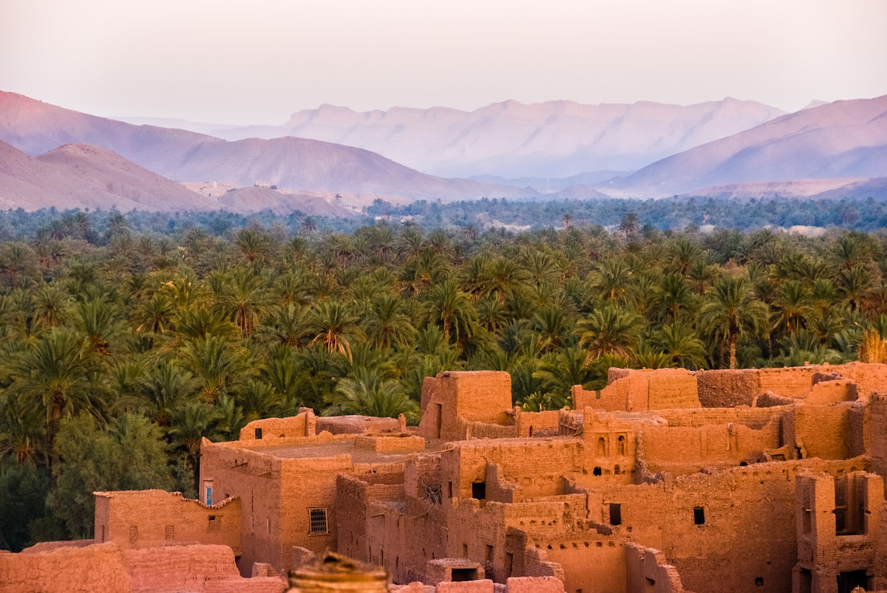

# Morocco and Egypt Are Leading Africa's EV Surge. Sub-Saharan Dealers Should Pay Attention.

**Category:** Market Analysis  
**Date:** July 5, 2026  
**Read Time:** 6 min  
**Tag:** Morocco · Egypt · North Africa · EV Adoption · Market Trends

---

*Casablanca — Morocco has built the most EV-friendly import environment in Africa, combining 0% import duty, minimal VAT on qualifying vehicles, and aggressive government fleet electrification targets.*

---

## Overview

When the IEA reported that African EV sales more than doubled in 2024, reaching nearly 11,000 units, that headline obscured a critical geographic reality: **the vast majority of that growth happened in two countries** — Morocco and Egypt — each of which exceeded 2,000 EV sales for the first time.

For Sub-Saharan African dealers, this is not irrelevant geography. North Africa consistently leads Sub-Saharan adoption curves by two to three years in automotive trends, and understanding what drove Morocco and Egypt's acceleration illuminates what Sub-Saharan markets will look like by 2027–2028.

---

## Morocco: The Most EV-Friendly Import Regime on the Continent

Morocco has constructed the most attractive EV import environment in Africa:

- **0% import duty** on qualifying electric vehicles
- **Minimal VAT treatment** — a $30,000 EV incurs approximately $750 in tariffs under Morocco's qualifying criteria
- **VAT exemption** for EVs meeting specific technical standards
- Active government fleet electrification programme for public administration vehicles

The result is a landed cost advantage that makes EVs directly price-competitive with equivalent ICE vehicles in several segments for the first time. Morocco's EV market grew from a negligible base to over 2,000 sales in 2024 — with Chinese brands capturing the majority of that growth.

Morocco's geographic position also makes it significant beyond its own market. As a manufacturing hub with proximity to Europe (and currently building relationships with several Chinese OEM assembly projects), Morocco is emerging as a potential regional distribution point for North and West African EV supply chains.

---

*Cairo — home to over 20 million residents and one of Africa's largest urban vehicle fleets. Egypt's 20,000 EV target by 2030 has been backed by concrete import incentives that are already driving results.*

---

## Egypt: Scale Market With a 2030 Target

Egypt's EV market development follows a different model from Morocco's. Where Morocco's growth is primarily driven by import incentives, Egypt has paired import policy changes with a **national 20,000 EV by 2030 target** backed by government fleet procurement commitments.

Egypt's EV import framework includes:
- Reduced customs duties for qualifying EVs (specific rates vary by vehicle class and country of origin)
- Government procurement targets driving public sector EV adoption
- Pilot charging infrastructure deployment in Cairo and Alexandria

Egypt exceeded 2,000 EV sales in 2024, matching Morocco's milestone. Given Egypt's much larger vehicle market (annual new car sales of 200,000–300,000 units versus Morocco's 150,000), the penetration rate remains lower — but the absolute growth trajectory is significant.

Chinese brands are particularly well-positioned in Egypt because China and Egypt have an existing strong trade relationship, and Chinese vehicles already have significant brand recognition in the Egyptian market through prior ICE imports.

## The Sub-Saharan Parallel: What Comes Next

The North Africa experience provides a clear pattern for Sub-Saharan market development:

**Phase 1 (Morocco/Egypt, 2022–2024):** Policy incentives create a cost advantage for EVs. Early commercial adopters — taxi operators, government fleets, logistics companies — lead adoption.

**Phase 2 (Emerging, 2024–2026):** Consumer awareness builds. Chinese brand marketing investment in the market increases as volume justifies the spend. Charging infrastructure begins to develop in major urban centres.

**Phase 3 (Projected, 2026–2028 for Sub-Saharan):** Individual consumer purchases begin to materialise alongside continued commercial fleet growth. Dealer networks need to be in place before this phase, not during it.

Kenya, South Africa, and Nigeria are approximately 18–24 months behind Morocco and Egypt on this curve. Dealers establishing market presence now are entering at the Phase 1-to-2 transition — the optimal moment to build brand and infrastructure before Phase 3 demand arrives.

## What Both Markets Have in Common

Despite their different policy approaches, Morocco and Egypt share characteristics that explain their relative success:

- **Urban density** — both have major metropolitan centres where the limited charging infrastructure challenge is manageable
- **Existing Chinese trade relationships** — Chinese vehicles were already familiar to consumers before the EV wave arrived
- **Government as a first mover** — public sector fleet electrification created visible, trusted early deployments that built consumer confidence
- **Regulatory clarity** — both markets have relatively clear import classification processes, reducing the compliance risk that deters dealers in some Sub-Saharan markets

---

## Sources

- IEA — *Global EV Outlook 2025*: Africa sales data
- EV24.Africa — *"EV Market Forecast in Africa to 2030"*
- Africa E-Mobility Alliance — *Africa E-Mobility Report 2025*
- EV24.Africa — *"EV Import Duty in Africa Explained: Country-by-Country Guide"* (Morocco and Egypt sections)

---

*Published by Evexport Intelligence Desk · July 2026*
