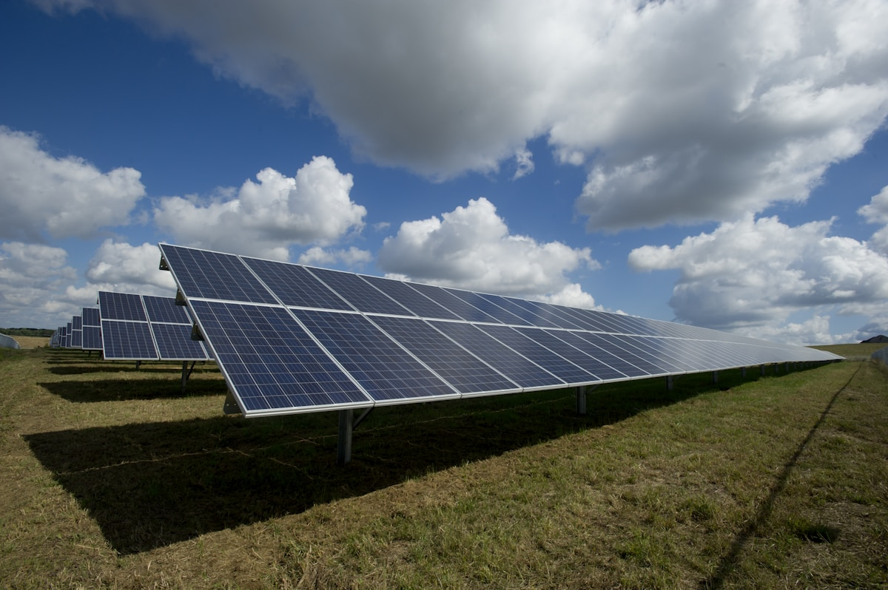
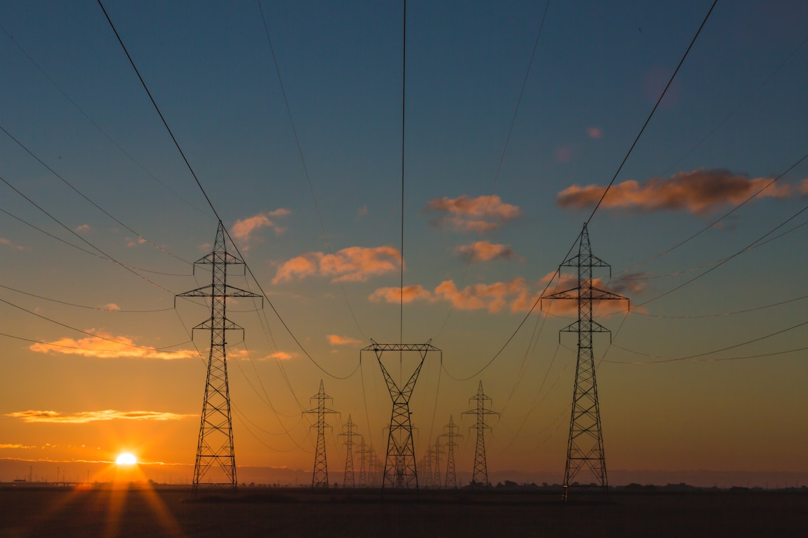

# Charging EVs When the Grid Is Unreliable: A Practical Guide for East African Operators

**Category:** Operator Hub  
**Date:** February 28, 2026  
**Read Time:** 7 min  
**Tag:** Charging Infrastructure · Solar EV Charging · Ethiopia · Grid Stability

---

*Ethiopia has 100,000+ EVs on its roads and approximately 2 fast-charging stations in Addis Ababa as of early 2026 (Africa E-Mobility Alliance, 2025). The charging infrastructure gap is real — but it is solvable with the right combination of depot charging, solar integration, and vehicle selection. This guide explains how.*

---

## Overview

The most common objection to EV adoption in East African commercial markets is not price, range, or technology — it is charging: "Where will we charge it? The electricity cuts out for hours every day."

This objection is legitimate. Ethiopia's grid reliability is a real operational constraint. Addis Ababa experiences load-shedding periods that vary from occasional to multiple hours daily, depending on the season and the city district. Nairobi's outer zones experience similar issues, though the city centre grid is more stable.

What this guide demonstrates is that the charging challenge is not an inherent barrier to EV adoption — it is a **solvable infrastructure problem** with commercial solutions that have been deployed in similar markets. Dealers who help their commercial customers solve the charging problem close more sales.

---

## The Four Charging Approaches for Unreliable Grid Markets

### Approach 1: Overnight AC Charging (Depot-Based)

The most practical and lowest-cost charging solution for commercial fleet operators is **overnight AC charging at a depot or parking facility**.

Most Chinese EVs accept 6.6 kW onboard AC charging as standard. At this rate, a fully depleted 30 kWh battery (BYD Seagull standard) charges in approximately 5 hours. A partially depleted battery (30-40% depleted at end of day from 150 km of commercial use) charges in 2–3 hours.

**Operational reality**: if a commercial taxi or ride-hailing vehicle returns to a depot or driver's home at 10 PM with 30–40% battery, a 6.6 kW charger can restore it to full by 1–3 AM. Even with a 2-hour load-shedding period overnight, a 6.6 kW charger running from a single-phase 240V connection will complete the charge cycle before the morning shift starts.

**What's needed**:
- A 3-socket single-phase 240V power supply (standard residential connection in Ethiopia and Kenya)
- A Type 2 EVSE (Electric Vehicle Supply Equipment) wallbox — approximately $150–$300 USD; some vehicles include a Type 2 cable
- A circuit breaker upgrade if the existing circuit cannot support 32A continuous draw

This is the entry-level charging solution. It costs less than $500 USD per vehicle connection and works reliably for commercial fleet operators who can establish overnight depot parking.

---

*DC fast charging (typically 40–100 kW) is the solution for vehicles that cannot charge overnight — but with only approximately 2 DC fast-chargers confirmed in Addis Ababa as of early 2026 (Africa E-Mobility Alliance, 2025), route planning around DC charger availability is not yet viable for most commercial operators.*

---

### Approach 2: Solar + Battery Storage System

For operators whose grid supply is too unreliable even for overnight AC charging — or for commercial facilities that want to charge during daylight hours — a solar photovoltaic system with battery storage is the solution.

Ethiopia's solar irradiance is excellent: Addis Ababa averages approximately 5.5–6.0 peak sun hours per day year-round, among the highest in East Africa.

**A practical commercial solar charging system**:
- 10 kW solar array (approximately 25 x 400W panels): generates ~55–60 kWh per day in Addis Ababa conditions
- 30 kWh battery storage: stores daytime generation for night use
- 7.4 kW AC EVSE: charges one vehicle per slot overnight

**System cost estimate (2026)**: A 10 kW solar + 30 kWh storage system installed in Addis Ababa runs approximately $8,000–$14,000 USD depending on installer, panel brand, and battery chemistry. At this price point, a system that charges 2–3 vehicles per night fully recovers its capital cost within 18–30 months compared to petrol fuel costs.

Several NGOs and development finance institutions — including UNEP and GIZ — have deployed solar EV charging pilot systems in Addis Ababa and Nairobi that provide reference installations and, in some cases, co-financing opportunities.

### Approach 3: Vehicle-to-Load (V2L) for Grid Independence

A subset of Chinese EVs supports **Vehicle-to-Load (V2L)** — the ability to use the vehicle's battery as a power source, running external appliances or other devices through a standard 220V outlet built into the vehicle.

V2L is relevant to East African operators not as a charging solution, but as a **grid resilience tool** at their facility. A BYD Atto 3 or similar V2L-capable EV can power a small commercial operation during load-shedding — running lights, computers, or low-draw equipment from its battery at no fuel cost.

This converts a perceived liability (EV is dependent on electricity) into an asset (EV provides electricity when the grid fails). This reframing is commercially significant in markets where diesel generator costs are a real operational expense.

Chinese EVs with confirmed V2L capability available in African markets:

| Model | V2L Output | Notes |
|-------|-----------|-------|
| BYD Atto 3 | 2.2 kW | Rear socket, 10A |
| BYD Seal | 3.3 kW | Requires export variant confirmation |
| Chery Tiggo 7e PHEV | Varies | PHEV generator capability different from V2L |
| Hyundai Ioniq 5 (non-Chinese, reference) | 3.6 kW | Strongest market V2L example |

V2L capability should be on the feature checklist when evaluating Chinese EV models for fleet deployment in markets with unreliable grid supply.

---

*A 10 kW solar installation in Addis Ababa generates approximately 55–60 kWh per day — enough to charge one full Seagull battery (30.1 kWh) and partially charge a second vehicle daily, entirely off-grid.*

---

### Approach 4: PHEVs as a Bridge Technology

Where grid reliability cannot be guaranteed and solar investment is not immediate, plug-in hybrid EVs (PHEVs) represent a pragmatic bridge.

A PHEV like the BYD Shark or Chery Tiggo 7e PHEV charges its battery from AC overnight but retains a petrol engine as backup for days when charging was incomplete or the battery is fully depleted. The vehicle never requires an emergency DC fast-charge that the market cannot provide.

For commercial fleet operators in Ethiopia — particularly those operating vehicles outside Addis Ababa — PHEVs eliminate the range/charging anxiety that makes pure BEV adoption feel risky. As the grid becomes more reliable and solar charging becomes more affordable, fleet operators can transition to pure BEVs while PHEVs serve as the fleet backbone in the interim.

---

## What Dealers Should Offer Their Customers

A Chinese EV dealer who sells a vehicle and does nothing about charging is selling half the product. The commercial customers who drive EV adoption in Ethiopia and Kenya want a turnkey solution — not just a vehicle.

**The minimum viable charging package**:
- Include a Type 2 charging cable in every vehicle sale
- Provide written guidance on the minimum electrical requirements for home/depot AC charging
- Recommend a specific electrical contractor in the buyer's city who can install the EVSE correctly

**The value-add package** (for fleet sales):
- Provide an assessment of the buyer's facility's charging capacity before the sale completes
- Connect the buyer with a solar integrator for a depot solar proposal
- Offer a first-year servicing agreement that includes a battery health check at 12 months

Dealers who offer this package are solving the real problem the commercial buyer has. Dealers who only offer a vehicle are leaving the hardest part of the buying decision unresolved.

---

## Sources

- Ethiopian Electric Power (EEP) — grid reliability data and load-shedding schedules (2025)
- IRENA — *Africa Solar Resource Map* (irradiance data for Ethiopia)
- UNEP/GIZ — Africa EV charging infrastructure pilot programmes (Addis Ababa, Nairobi, 2024–2025)
- BYD official — V2L specifications for Atto 3 and Seal (2025)
- Africa E-Mobility Alliance — *Africa E-Mobility Report 2025* (charging infrastructure chapter)
- EV24.Africa — *"Charging EVs in Africa: Infrastructure Guide"* (2025)

---

*Published by Evexport Intelligence Desk · February 2026*
