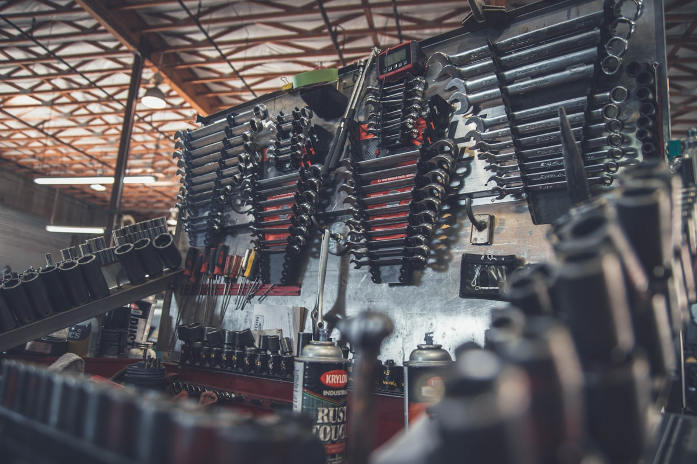
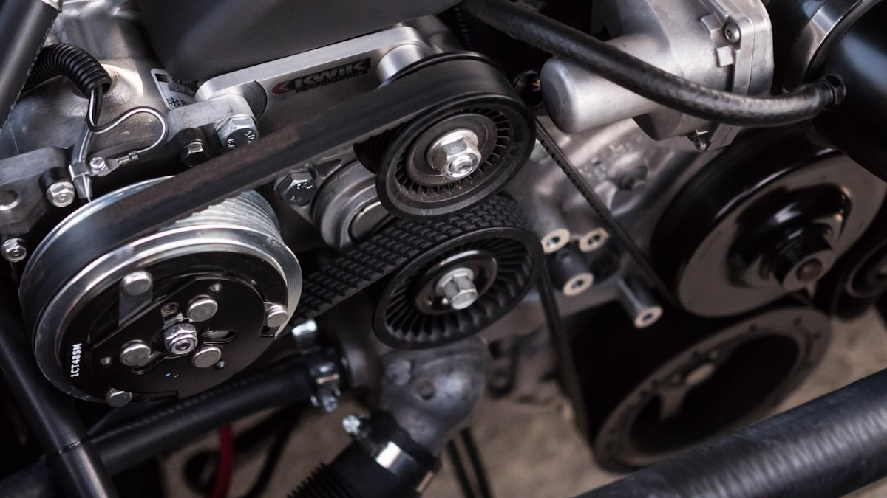

# Building a Chinese EV Spare Parts Supply Chain in Ethiopia Without an Official OEM Network

**Category:** Operator Hub  
**Date:** March 10, 2026  
**Read Time:** 8 min  
**Tag:** Spare Parts · After-Sales · Ethiopia · EV Maintenance

---

*No Chinese EV OEM has an official authorised parts distribution centre in Ethiopia as of mid-2026. Every Ethiopian EV dealer operating without a formal OEM franchise is building their own parts supply chain. This guide covers how to do it without leaving customers stranded.*

---

## Overview

The Africa E-Mobility Alliance's 2025 report identified spare parts availability — specifically, parts within 30 days — as the single most important factor in commercial fleet buyer decision-making. More important than purchase price. More important than range. More important than brand.

For Ethiopian EV dealers operating without official OEM franchise relationships — which is the current reality for virtually all Chinese EV importers in Ethiopia — this creates an operational challenge that is also a competitive differentiation opportunity. The dealer who solves the parts supply problem gains a durable advantage that cannot be matched by price competition alone.

This guide outlines the practical architecture for building a spare parts supply chain in Ethiopia without an OEM parts distribution agreement.

---

## The Parts Priority Hierarchy

Not all EV parts carry the same supply urgency. The starting point for any parts strategy is understanding which categories create the most customer exposure risk.

**Tier 1 — Critical (1–2 week maximum acceptable lead time):**
- High-voltage fuses and contactors
- 12V auxiliary battery
- Charging port and inlet assembly
- Brake pad sets and brake fluid
- Cabin air filters and pollen filters
- Wiper blades

These are high-frequency consumable and safety items. Running out of brake pads or having a faulty charging inlet creates immediate operational downtime for a commercial vehicle.

**Tier 2 — Important (4 weeks acceptable):**
- BMS (Battery Management System) control module
- Onboard charger module
- DC-DC converter
- Suspension components (shock absorbers, control arm bushings)
- Cooling system components (water pump, coolant lines for battery thermal management)
- Tyres (local sourcing usually possible but size availability varies)

**Tier 3 — Long-lead items (6–12 weeks from China acceptable if managed proactively):**
- High-voltage battery pack (full or cell-level replacement)
- Main drive motor or motor controller
- Power distribution unit (PDU)
- Body panels and structural components

The Tier 3 list is where most EV dealers get into trouble. A dealer whose customer's vehicle is immobilised waiting for a drive motor from China — with a 10-week lead time — has a retention problem that price competition cannot solve.

---

*Ethiopian EV technicians trained on Chinese EVs exist in growing numbers in Addis Ababa — the constraint is parts supply, not technical capability. A well-stocked consignment inventory for Tier 1 and Tier 2 parts is the single highest-impact operational investment an EV dealer can make.*

---

## Building Your Parts Supply Architecture

### Step 1: Identify Your Core Fleet Models and Map Their Parts

Start with the specific vehicles in your customer fleet — or the specific models you import. Parts are model-specific. A BYD Seagull charging port does not fit a BYD Atto 3. A Chery Tiggo suspension component does not cross to a BYD Dolphin.

For each model you service, map:
- The full service interval parts list (from the OEM service manual — obtain from your Chinese supplier)
- The most common failure modes reported by other operators of that model
- The fast-wear consumables specific to Ethiopian conditions (dust ingress, heat, road conditions)

Ethiopian conditions are harder on certain components than Chinese conditions. Dusty roads affect air filtration systems more aggressively. Unpaved surfaces increase suspension component wear. High ambient temperatures stress cooling systems. Your parts inventory should weight toward categories where Ethiopian conditions accelerate wear.

### Step 2: Establish a Chinese Parts Supplier

For Chinese EV parts, you have three sourcing options:

**Option A: Order through your vehicle supplier.** Your Chinese vehicle exporter may also supply parts. Convenient for documentation and relationship management, but typically higher price and same lead time as ordering directly.

**Option B: Order from a Chinese auto parts marketplace.** Platforms like Yiche (易车) parts, 1688 (Alibaba B2B), and Chinese EV-specific parts suppliers on Alibaba allow direct purchase. Lower price than going through an exporter, but requires you to identify and verify the correct part numbers independently.

**Option C: Source from third-country distributors.** Dubai is the primary hub for Chinese EV parts redistribution for the Africa and Middle East region. Some Chinese brands have parts distribution operations in Dubai with faster East Africa shipping than China-direct ordering. Compare pricing and lead times — Dubai-sourced parts add a markup but can arrive in 2–4 weeks versus 8–12 weeks from China.

**Part number accuracy**: This is the most critical operational skill for independent parts sourcing. Incorrect part numbers are expensive — you pay for a part and then discover it doesn't fit. Request the OEM service manual and the official parts catalogue number before ordering. Your Chinese vehicle supplier should provide these at sale.

### Step 3: Build a Consignment Inventory

A consignment inventory — parts held in your warehouse against anticipated future demand — eliminates the waiting time for your most critical items. The upfront cost is real, but so is the customer retention value.

A practical starter consignment inventory for an Ethiopian dealer maintaining 20–30 vehicles *（以下建议数量为参考值，基于行业实践经验，实际根据车队规模和车型组合调整）*：

| Part Category | Recommended Stock Level |
|--------------|------------------------|
| 12V auxiliary batteries (matched to fleet models) | 4–6 units |
| Charging cables (Type 2, matching fleet inlets) | 3–4 units |
| Charging port assemblies | 2 units per model |
| Brake pad sets (front + rear) | 8–10 sets per model |
| Air filters + pollen filters | 10 sets per model |
| Coolant (EV-grade) | 20 litres |
| High-voltage fuses (assorted, matched to fleet) | 20–30 units |
| BMS modules (if sourced; high value but critical) | 1–2 units |
| Suspension bushings (front subframe) | 4 sets per model |
| Wiper blade sets | 10 sets |

Invest in this inventory before you need it. The cost of stocking it is far lower than the cost of a commercial customer whose vehicle is idle for 8 weeks while a part travels from Shenzhen.

### Step 4: Develop an Ethiopian Technical Capability

Parts supply is necessary but not sufficient. Parts must be installed correctly. In Addis Ababa, EV-trained technicians exist in growing numbers — trained through manufacturer training programmes, YouTube-mediated self-learning, and formal TVET programmes that began incorporating EV content from 2023 onwards.

Invest in:
- Sending 1–2 mechanics to a formal Chinese EV technical training programme (several Chinese OEMs offer this in Guangzhou or through African partners)
- Purchasing a basic EV diagnostic tool compatible with your fleet models (most Chinese EVs use OBD2 with brand-specific diagnostic apps)
- Joining or establishing an informal network with other Ethiopian EV dealers for parts sharing and technical knowledge exchange

---

## The Competitive Advantage Calculation

A dealer who can resolve a customer's EV issue in 3 days — versus a competitor who quotes 10 weeks — does not need to compete on price. That service differential is worth thousands of USD in customer lifetime value.

Commercial fleet buyers — taxi operators, NGOs, government entities — make repeat vehicle purchase decisions. The fleet operator whose 30 Seagulls were reliably serviced by your team becomes your customer for the next 30 vehicles. The fleet operator whose vehicles sat idle waiting for parts goes to whoever promises them they've solved the problem.

Parts supply is not a logistics problem. It is a customer retention strategy.

---

## Sources

- Africa E-Mobility Alliance — *Africa E-Mobility Report 2025* (after-sales infrastructure section)
- Alibaba / 1688 — Chinese auto parts B2B marketplace (reference for sourcing methodology)
- BYD official — service manual and parts catalogue availability policy
- Ethiopian Technical and Vocational Education and Training (TVET) Agency — EV curriculum status (2023–2025)
- 迪拜汽车零件集散市场 — 迪拜是中国EV零件在中东/非洲地区的主要转运集散地，部分经销商通过迪拜中间商可将到货周期压缩至3-4周（编辑注：基于行业实践，非特定机构数据）

---

*Published by Evexport Intelligence Desk · March 2026*
