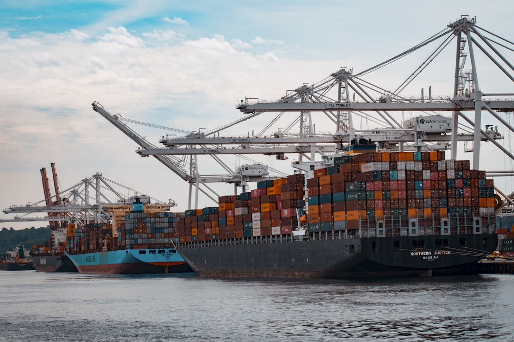

# China Halves Its EV Purchase Tax — And African Dealers Are the Unexpected Winners

**Category:** Policy & Tariffs  
**Date:** April 18, 2026  
**Read Time:** 8 min  
**Tag:** China NEV Policy · Export Market · Pricing · Africa Opportunity

---

*China produced over 12 million NEVs in 2025. The domestic policy shift that begins in 2026 sends the excess output looking for new markets — including Africa.*

---

## Overview

Two policy events collided in January 2026 to create the most favourable conditions ever seen for African dealers sourcing EVs from China.

**First**: China's NEV purchase tax exemption was halved — from a full 100% waiver to a 50% waiver — as of January 1, 2026. This softens one of the key domestic demand stimulants that Chinese manufacturers had relied on for three years.

**Second**: China's NEV exports surged **75.2% year-on-year in the first half of 2025**, reaching 1.06 million units shipped overseas, as manufacturers aggressively sought to replace the revenue headwinds from Western market tariffs (US: 100%, EU: up to 37.6%, Canada: 100%).

The result of these two forces converging: Chinese OEMs are entering 2026 with both a domestic demand headwind and a closed Western export door. Africa — with no retaliatory tariffs, a growing dealer base, and improving policy environments — is the logical beneficiary.

---

## Understanding the Purchase Tax Change

China's vehicle purchase tax is levied at **10%** of the vehicle's pre-tax price. During the peak subsidy years (2024–2025), this was waived entirely for qualifying NEVs — saving buyers up to ¥30,000 ($4,100) per vehicle.

From January 1, 2026, the exemption was restructured:

| Period | Purchase Tax Treatment | Maximum Benefit |
|--------|----------------------|-----------------|
| 2024–2025 | 100% exemption | ¥30,000 per vehicle |
| **2026–2027** | **50% exemption** | **¥15,000 per vehicle** |
| 2028+ | To be determined | — |

The halving of the benefit affects primarily the domestic Chinese consumer. For the export market, the direct impact on pricing is indirect — but the strategic implications are significant.

---

*China's car export terminals are running at capacity. With Western markets closed by tariffs, African and Southeast Asian dealers are receiving increasing commercial attention from Chinese OEMs.*

---

## The Export Surge: What the Numbers Show

China's NEV export performance through 2025 was exceptional by any measure:

- **H1 2025**: 1.06 million NEVs exported, up 75.2% year-on-year
- **Full-year 2025**: Made-in-China vehicle exports approached the 2024 total through the first 10 months alone, tracking toward a new record
- **NEV share of total exports**: 35.5% of all Chinese vehicle exports were new energy vehicles

The primary driver of this surge was not Africa — it was Southeast Asia and Latin America, which absorbed the bulk of the redirected volume. But the trend is clear: as Western markets erected tariff walls, Chinese OEMs pivoted toward open markets with speed and commercial aggression.

Africa is increasingly on that list. In 2024, Chinese imports accounted for **75–85% of EV sales** across key emerging markets — reaching 85% in Brazil and Thailand, according to IEA data. The African market, where Chinese brands have been active in ICE vehicles for over a decade, is a natural extension.

---

*Chinese OEM pricing for export markets has become more negotiable as domestic sales stimulants are reduced — dealers who understand this dynamic are in a stronger position.*

---

## The Negotiating Implication for African Dealers

Here is the practical translation of these macro forces into a dealership conversation:

**The domestic price war is real and ongoing.** In China's home market, more than 30 brands are competing aggressively for share, with list prices dropping on multiple models through 2024 and 2025. Manufacturers who cannot sustain market share domestically are disproportionately reliant on export volumes to maintain factory utilisation.

**Reduced domestic incentives increase export pressure.** As the purchase tax benefit shrinks from ¥30,000 to ¥15,000, domestic sales will soften marginally in the first half of 2026. Manufacturers will look to export markets to compensate — and export pricing, minimum order quantities, and payment terms all become more negotiable when the factory needs the volume.

**The window is now.** When Western tariffs first hit in mid-2024, Chinese OEMs were still adjusting their export strategies. By late 2025 and into 2026, they have operationalised their Africa-focused teams, established regional distribution partnerships, and allocated dedicated export inventory. A dealer who engages now, rather than 12 months from now, will secure better pricing, better payment terms, and more responsive after-sales support than a dealer entering the conversation when the market matures.

## Three Things to Do Before Your Next Order

1. **Request competitive quotes from at least three OEM exporters** for the same model. The spread between the highest and lowest legitimate quote in the current environment is often 8–15% — directly attributable to individual manufacturers' export hunger.

2. **Ask about factory production slots**, not just stock on hand. Manufacturers with excess capacity are offering dedicated production slots with custom specifications (right-hand drive, specific colour, optional equipment) at lead times that would have been impossible two years ago.

3. **Negotiate payment terms, not just unit price.** Deferred payment terms of 60–90 days, previously available only to the largest volume buyers, are increasingly being offered to mid-tier African dealers as Chinese OEMs compete for market share outside their home market.

---

## Sources

- SMM News / Metal.com — *"Review of 2025H1 China's NEV Market: Dual New Policies + Purchase Tax Exemptions + Price Wars"*
- Automobility — *"State of China's Auto Market — September 2025"*
- CarnewsChina — *"China ends full EV tax exemption in 2026, dealerships report year-end sales rush"* (November 2025)
- IEA — *Global EV Outlook 2025*
- SCMP — *"Chinese EV makers bypass EU and US tariff roadblock by turning towards Africa"*

---

*Published by Evexport Intelligence Desk · April 2026*
