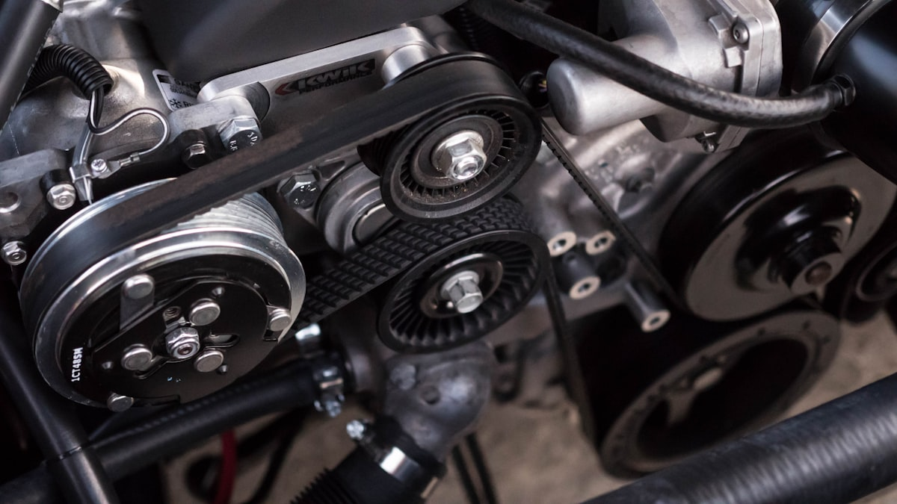

# The Zero-Kilometre Grey Market Is Officially Over

**Category:** Policy & Tariffs  
**Date:** January 15, 2026  
**Read Time:** 8 min  
**Tag:** China Export Policy · Import Compliance · Africa Market

---

*China RoRo export terminal. Starting January 2026, vehicles less than 180 days old require OEM documentation to clear customs.*

---

## Overview

For years, a quiet arbitrage existed at the edges of China's automotive export machine. Vehicles would roll off the production line, get registered in a Chinese city to meet a monthly sales quota or unlock a government subsidy, and then — having never been driven — get routed through used-car channels to buyers in Southeast Asia, Central Asia, and Africa.

These are **"zero-kilometre used cars"** (零公里二手车): technically "used" on paper, but practically brand new, often with protective film, floor mats, and interior covers still intact.

Starting **January 1, 2026**, Beijing moved to close this channel permanently. The impact on how African dealers source vehicles from China is direct and immediate.

---

## What Is a Zero-Kilometre Used Car?

A zero-kilometre used car is a vehicle with either zero mileage or only a few hundred kilometres accumulated during factory transport and dealer storage. It is exported under the classification of a "used vehicle" despite being mechanically and cosmetically identical to a new unit off the showroom floor.

The practice served multiple commercial purposes simultaneously:

- **Sales quota gaming** — Manufacturers registered vehicles to meet monthly or quarterly targets, even when no real end buyer existed. Registration equalled a "sold" unit in the books.
- **Subsidy capture** — During China's peak NEV subsidy era (2020–2023), registering an electric vehicle was sufficient to trigger government purchase incentives, regardless of whether a consumer ever took ownership.
- **Price floor circumvention** — By routing excess inventory through "used car" export channels, OEMs could offer deep discounts without officially cutting new-car sticker prices in the domestic market, protecting brand positioning at home while clearing stock abroad.

The result: a parallel supply of near-new vehicles entered markets like Kenya, Nigeria, Ethiopia, and Tanzania at prices **15–25% below official new-car import rates** — but with no manufacturer warranty, no OEM after-sales support, and a title chain that regulators in both China and the destination country could not cleanly trace.

---

*"Zero-km used cars" left the factory looking exactly like this — and were exported as "used vehicles" through trader channels.*

---

> *"The vehicle had 47 kilometres on the odometer and still had the factory plastic on the steering wheel. My supplier insisted it was 'used.' I had no idea I was buying into a grey market until the warranty claim was rejected."*
>
> — African importer, Nigeria, 2025

---

## The New 180-Day Rule, Explained

Under China's updated vehicle export regulations effective **January 1, 2026**, any vehicle exported within **180 days of its initial registration date** must now be accompanied by an official **After-Sales Service Confirmation Document** (售后服务确认书), issued directly by the vehicle manufacturer.

### Document Requirements

| Requirement | Detail |
|-------------|--------|
| Export destination | Must specify the exact destination country |
| Vehicle information | VIN, model, registration number |
| Issuing authority | Official OEM seal — not a dealer, trader, or logistics agent |
| Enforcement point | Chinese customs at port of departure |

Without this document, customs will **refuse export clearance** for any vehicle registered less than six months prior. The vehicle cannot legally leave China.

The 180-day threshold was chosen to precisely target the shortest-cycle grey market operations — where vehicles were registered and re-exported within weeks of rolling off the production line.

---

## What This Means for African Dealers

The impact concentrates in two areas.

**First, the grey-market supply channel tightens considerably.** Traders in Guangzhou, Tianjin, and Chongqing who offered "barely used" inventory at steep discounts are now exposed to inventory write-offs, customs refusals at the Chinese port of departure, and potential regulatory penalties. Dealers who were unknowingly buying from this pipeline face disruption to their supply and pricing expectations.

**Second, compliance becomes a buyer's responsibility.** Vehicles arriving from China that are less than six months old must now carry OEM documentation by law. If a supplier cannot produce this document for a recently-manufactured vehicle, it is a direct compliance red flag — one that could affect your own import clearance at Mombasa, Lagos, or Djibouti.

---

## How to Verify Your Vehicle Before Buying

Three verification steps every African importer should apply as standard practice when sourcing vehicles manufactured or registered in 2025–2026:

1. **Request the registration certificate** (行驶证 or 机动车登记证书) and cross-check the registration date against the manufacture date printed on the VIN plate inside the door jamb. A significant gap — or a registration date that precedes your order date — warrants investigation.

2. **For any vehicle registered within the last six months:** require the OEM After-Sales Service Confirmation Document before signing any purchase agreement or transferring any deposit. A legitimate seller sourcing through official OEM channels will have this document readily available.

3. **Verify document authenticity:** the document must carry the manufacturer's official stamp (公章), not a dealer or trading company stamp. For major brands, OEM regional export offices in Shanghai, Guangzhou, or Shenzhen can verify document legitimacy by VIN upon request.

---

*Always cross-check the registration date against the VIN manufacture date on the door jamb plate.*

---

## The Compliance Advantage for Authorized Partners

Paradoxically, this regulation creates a cleaner competitive landscape for dealers who have always sourced through official channels.

When grey-market supply of discounted zero-km inventory tightens, the price gap between unofficial and official sourcing narrows. Dealers who built proper OEM relationships — with documented supply chains, genuine warranties, and manufacturer support — are no longer systematically undercut by traders delivering a near-identical product through an opaque loophole.

For the African EV market, still in its formative stage, this shift matters beyond pricing. Consumer trust in Chinese EVs is directly tied to after-sales experience. A vehicle sold without warranty, without OEM documentation, and without proper service history is a liability that can damage the reputation of an entire product category in a local market — not just one dealership.

The dealers who will lead the next phase of African EV growth are those who can demonstrate **transparent, traceable, fully-compliant supply chains** from Chinese factory to local showroom floor. The 180-day rule, whatever its enforcement friction in the short term, moves the market firmly in that direction.

---

## Sources

- CarnewsChina — *"China targets zero-kilometre used cars with new 180-day export rule effective 2026"* (December 2025)
- ChinaEVHome — *"China Moves to Regulate Used-Car Exports, Restricts Zero-Mileage Used Cars"* (November 2025)
- AutoCango — *"China's New 180-Day Rule for Auto Exports: Key Changes Effective Jan 1, 2026"*
- ForexLive / TradingView — *"China cracks down on zero-mileage auto exports used to inflate sales and claim tax perks"*

---

*Published by Evexport Intelligence Desk · January 2026*
