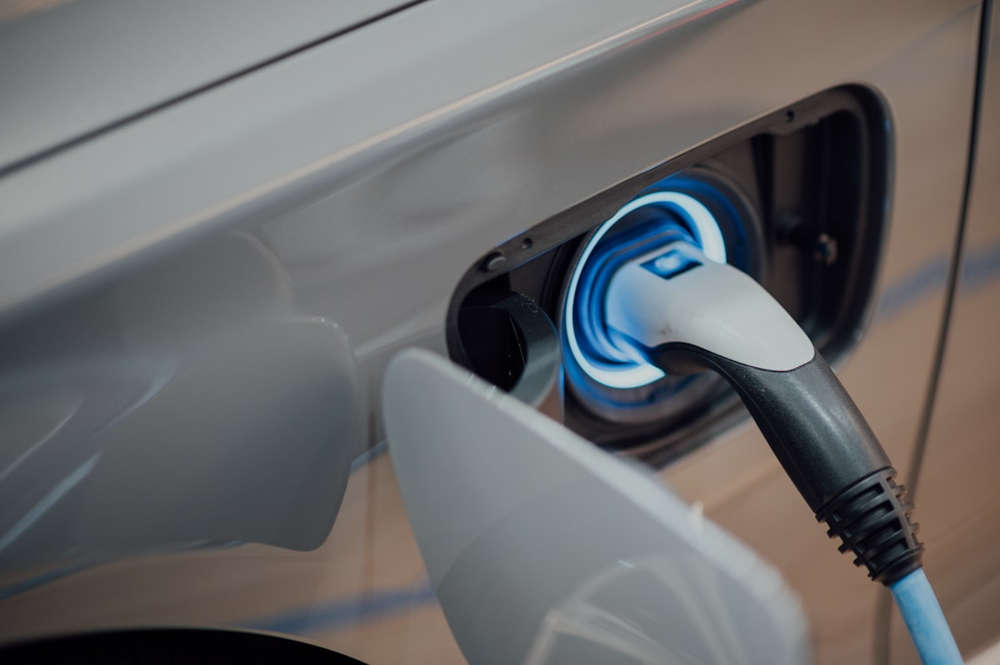

# Ethiopia's EV Tax Policy: Three Years, Three Reversals

**Category:** Policy & Tariffs  
**Date:** February 10, 2026  
**Read Time:** 7 min  
**Tag:** Ethiopia · Import Duty · VAT · Africa Policy

---

*Addis Ababa — the fastest-growing capital in Africa and the centre of Ethiopia's radical EV experiment.*

---

## Overview

In September 2022, Ethiopia made international headlines as one of the first African nations to completely waive VAT, excise tax, and surtax on electric vehicle imports. Eighteen months later, it became the first country in the world to outright ban the import of internal combustion engine (ICE) vehicles. The narrative looked clean: a bold green leap by a developing economy.

The reality, for importers on the ground, is considerably messier. A series of policy reversals between 2024 and 2025 has quietly unwound some of those headline-grabbing incentives — while the ICE ban remains firmly in place. Understanding what is still in effect, what has changed, and what the actual landed cost looks like today is essential for any dealer considering Ethiopia as a target market.

---

## The Policy Timeline

### 2022: The Breakthrough

In September 2022, Ethiopia's Ministry of Finance issued a directive exempting all electric vehicles from:

- **VAT** (Value Added Tax) — standard rate 15%
- **Excise Tax** (Consumption Tax) — applied at various rates depending on vehicle type
- **Surtax** — an additional levy on top of customs

Customs duty was reduced to **15% for fully assembled EVs** (CBU) and **5% for semi-knocked-down units** (SKD). Completely Knocked Down (CKD) kits for local assembly were duty-free.

This was a genuine breakthrough. For the first time, an African government had made electric vehicles structurally cheaper to import than petrol equivalents on a total tax basis.

### January 2024: The ICE Ban

Ethiopia doubled down, becoming the **first nation globally to ban ICE vehicle imports** entirely. The ban initially covered fully built units (CBU). In May 2025, the government expanded the ban to include SKD and CKD kits for ICE vehicles, closing the local-assembly loophole.

For dealers, this was unambiguously positive — it locked in EV demand structurally, with no petrol alternative to compete against on price.

---

*Ethiopia's tax structure for EV imports has been revised three times since the 2022 exemption directive — importers must calculate landed cost based on current rules, not headlines.*

---

### August 2024: The Silent Reversal

Here is where the story diverges from the headlines.

In August 2024, Ethiopia's Ministry of Finance issued **Directive No. 1006/2024**, introducing a new consolidated VAT framework. A critical clause within the directive revoked all previous VAT exemptions that had been granted through separate ministerial directives — including the 2022 EV exemption.

The Ethiopian government did not announce this as an EV policy change. It was framed as a tidying exercise to consolidate the VAT exemption list. The practical effect, however, was that **EVs were no longer automatically exempt from the standard 15% VAT**.

### November 2024: Customs Duty Increase

Separately, under pressure from the International Monetary Fund to broaden the national tax base, the customs duty on imported EVs was raised from **15% to 20%** for CBU units. SKD rates were also adjusted upward.

---

## What the Real Landed Cost Looks Like Today

As of early 2026, the effective tax structure for a fully assembled EV imported into Ethiopia is:

| Tax Type | 2022 (Original) | Current (2026) |
|----------|-----------------|----------------|
| Customs Duty (CBU) | 15% | **20%** |
| VAT | 0% (exempted) | **15% (reinstated)** |
| Excise / Consumption Tax | 0% (exempted) | Unclear — under review |
| Surtax | 0% (exempted) | Unclear — under review |

On a $20,000 vehicle, the difference between the 2022 headline policy and today's actual structure is substantial — potentially $5,000–$7,000 in additional taxes depending on the excise treatment applied.

**The ICE ban, however, remains fully in force.** Ethiopia's EV market is growing — the EV fleet tripled between 2023 and 2025 — but importers must build their financial models on the current tax reality, not the 2022 announcement.

---

*EV imports into Ethiopia have grown rapidly despite the policy reversals — but accurate cost modelling is now essential.*

---

## What This Means for Dealers

**Ethiopia remains one of Africa's most structurally compelling EV markets.** The ICE ban removes the single biggest competitive threat to EV adoption. Demand is real and growing.

However, three lessons apply:

1. **Price based on current tax reality, not 2022 incentive announcements.** Many traders in the market are still quoting landed costs that do not reflect the VAT reinstatement or the customs duty increase.

2. **Monitor excise and surtax status actively.** These exemptions may still be in effect for some categories of EV — but their legal basis needs current verification, not reliance on the original 2022 directive.

3. **SKD and local assembly remain the most tax-efficient route.** CKD/SKD kits for EV assembly retain favourable treatment and are not subject to the ICE ban, making local partnership models worth exploring for volume players.

---

## Sources

- CleanTechnica — *"All EVs In Ethiopia Now Exempted From VAT, Surtax & Excise Tax"* (October 2022)
- Addis Insight — *"Ethiopian Government Raises Customs Duty on Imported Electric Vehicles"* (November 2024)
- EY Global Tax Alerts — *"Ethiopia issues directive to review list of goods exempt from VAT"* (2024)
- Orbitax — *"Ethiopia Limits VAT Exemptions"* (2024)
- FurtherAfrica — *"Ethiopia's EV Fleet Triples in Two Years After Fuel Car Ban"* (June 2025)

*本文税率基于埃塞俄比亚2024年第1006号指令（2024年8月生效）整理。埃塞俄比亚EV进口税政策已于2022年及2024年两度重大调整，建议在正式下单前向ERCA及持牌清关行确认当前有效税率，以当局最新公告为准。*

---

*Published by Evexport Intelligence Desk · February 2026*
