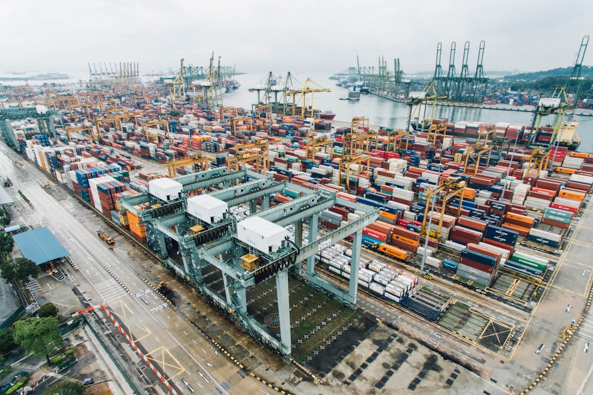

# Ghana's 8-Year Zero-Tariff Window: The Best Local Assembly Deal in West Africa

**Category:** Policy & Tariffs  
**Date:** April 2, 2026  
**Read Time:** 5 min  
**Tag:** Ghana · West Africa · CKD · Local Assembly · Zero Tariff

---

*Accra's transport sector is the designated beneficiary of Ghana's eight-year EV import exemption — creating a structured opportunity for fleet-scale dealers.*

---

## Overview

Ghana's EV import policy is deliberately narrow — and that specificity is what makes it commercially interesting. Unlike blanket exemptions that apply to all EV categories regardless of use, Ghana's zero-tariff framework introduced in 2024 targets **public transport electric vehicles** and **local assembly operations** with an incentive window running through 2032.

For dealers and assemblers positioned to serve Ghana's formal public transit sector, or those exploring CKD/SKD assembly as a business model, this policy offers the most concrete long-term certainty of any EV incentive currently active in West Africa.

---

## What the Policy Covers

According to EV24.Africa's reporting on Ghana's automotive import framework, the following exemption structure applies:

| Vehicle / Component Category | Import Duty | Duration |
|------------------------------|------------|----------|
| EVs used for **public transportation** | **0%** | Until 2032 |
| **SKD kits** imported by registered EV assemblers | **0%** | Until 2032 |
| **CKD kits** imported by registered EV assemblers | **0%** | Until 2032 |
| Private EVs (non-public transport) | **20%** | Standard rate |

The distinction between public transport and private vehicle use is the defining feature of this policy. A bus operator or a ride-hailing platform that can demonstrate commercial fleet use qualifies. An individual buyer of a private sedan does not.

---

*Ghana's zero-tariff benefit applies to EVs operating in the formal public transport sector — creating a fleet-scale import opportunity for credentialled operators.*

---

## The Local Assembly Angle

The SKD and CKD exemption is the most strategically significant element for the medium term. Ghana has an established history of vehicle assembly — Kantanka Automobile has been producing vehicles locally since 2017 — and the government's stated objective is to develop domestic EV manufacturing capability, not simply to maximise imported vehicle volumes.

For Chinese OEM partners with the capacity to supply CKD kits rather than CBU units, this creates a compelling proposal:

- **Lower landed cost** via the zero-tariff CKD route
- **Legitimate "made in Ghana" positioning** for fleet procurement tenders
- **First-mover advantage** in a market where local assembly capacity for EVs is still essentially zero

The registration requirement — importing assemblers must be formally registered with Ghana's automotive industry body — is the primary compliance step, and one that signals the government's intent to build a traceable, accountable supply chain rather than simply waiving tariffs for any operator.

## What This Means for Fleet Dealers

The 2032 horizon gives operators eight years of cost certainty — a long enough window to build a viable public transport fleet business and amortise the investment in charging infrastructure, workshop training, and spare parts inventory.

Key commercial targets within Ghana's public transport EV market:

- **Urban minibus (tro-tro) electrification** — the dominant informal transit mode in Accra; several electrification pilots are under way
- **Government fleet procurement** — the Ministry of Transport has signalled interest in EV adoption for official vehicle pools
- **Airport and port shuttle services** — high-frequency, fixed-route operations where EV economics are strongest

## Practical Steps

Dealers looking to access the zero-tariff benefit for public transport EV imports must:

1. Register as a commercial vehicle operator or fleet manager with the relevant Ghanaian authority
2. Confirm intended vehicle use as public transport at point of customs entry
3. Ensure the vehicle HS code clearly classifies the unit as a battery electric vehicle (BEV)

For the CKD/SKD route, additional registration as an approved assembler is required — a more complex process, but one that unlocks both the zero-tariff benefit and eligibility for future government procurement programmes.

---

## Sources

- EV24.Africa — *"Ghana EV Import Guide 2025: Tariffs, Registration & Customs Clearance"*
- EV24.Africa — *"EV Import Duties in Africa (2026): The Countries With the Best Incentives"*
- Africa E-Mobility Alliance — *Africa E-Mobility Report 2025*

*本文关税豁免信息基于EV24.Africa的行业报道。建议在执行前向加纳税务局（GRA）官方渠道或持牌清关行核实当前有效文件编号及注册要求。*

---

*Published by Evexport Intelligence Desk · April 2026*
