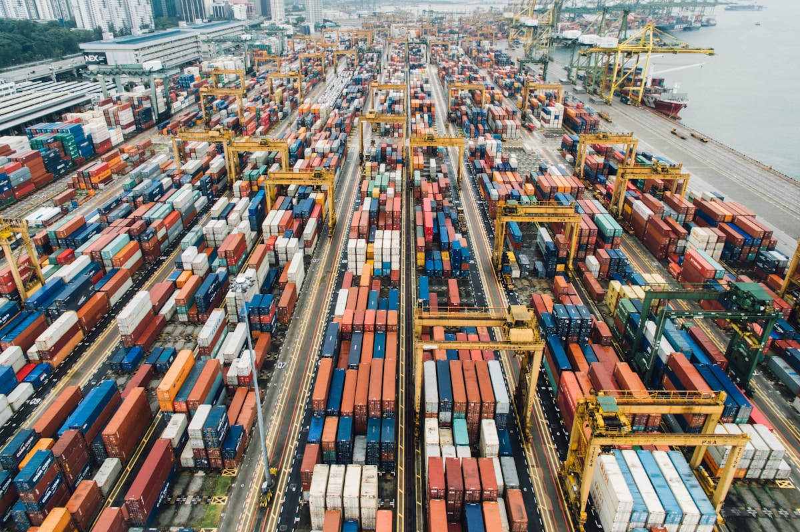

# How RoRo Freight Costs Are Structured: A Framework for African EV Importers

**Category:** Pricing & Trade  
**Date:** February 10, 2026  
**Read Time:** 6 min  
**Tag:** RoRo Freight · Shipping Costs · Logistics · China Africa Trade

---

*RoRo (Roll-on Roll-off) shipping is the dominant method for vehicle exports from China to Africa. Understanding how RoRo freight costs are structured — base rates, surcharges, and variable factors — allows importers to budget accurately and negotiate effectively.*

---

## Overview

Most African EV importers receive a single freight quote from their forwarder and treat it as a fixed cost. The reality is more complex: RoRo freight pricing is composed of multiple components, each of which can vary based on carrier, lane, timing, vehicle type, and market conditions.

Understanding the structure of RoRo freight costs — rather than just the bottom-line number — allows importers to identify the factors within their control, benchmark quotes from different providers, and anticipate cost changes before they affect margins.

This is a framework article. It explains how RoRo costs are built up, what each component represents, and what variables affect each. It does not quote current rates, which change frequently and must be obtained from your freight forwarder or carrier directly.

---

## The RoRo Freight Cost Components

### 1. Base Ocean Freight (BOF)

The base freight rate is the core charge for moving a vehicle from the Chinese loading port to the African destination port on the RoRo vessel. It is quoted in USD per vehicle, based on a CEU (Car Equivalent Unit) classification.

CEU classification reflects the physical footprint of the vehicle on the car deck:

| Vehicle Type | CEU | Relative Base Rate |
|-------------|-----|-------------------|
| Small hatchback (BYD Seagull, MG4) | 1.0 | Lowest |
| Compact SUV (BYD Atto 3, Chery Tiggo) | 1.0–1.2 | Low-Medium |
| Large SUV / pickup (BYD Shark 6) | 1.3–1.6 | Medium-High |
| Electric bus / commercial van | 2.5–4.0 | High |

Base freight rates reflect the lane supply-demand balance, fuel costs, and carrier capacity utilisation. China–East Africa rates have historically been lower than China–Europe or China–US rates due to lower lane volume, but have been elevated in 2024–2026 due to Red Sea disruptions.

### 2. Bunker Adjustment Factor (BAF)

The BAF is a fuel surcharge that carriers adjust periodically (typically quarterly) to reflect changes in marine fuel costs. When oil prices rise, BAF rises. When they fall, BAF falls.

BAF is typically quoted as a USD amount per CEU and is **separate from the base freight**. A common mistake is to compare freight quotes that include BAF against quotes that exclude it — ensure you are comparing apples to apples.

---

*The Red Sea disruptions since late 2023 have bifurcated China–East Africa freight into Suez Canal routing (faster, lower fuel cost but higher risk surcharges) and Cape of Good Hope routing (safer but 14–21 days longer and higher fuel cost). Both routes carry different cost structures.*

---

### 3. Port Surcharges

Carriers add port-specific surcharges that reflect the cost of handling at each port. These typically include:

**Port congestion surcharge (PCS)**: applied when a port is operating above normal capacity. Djibouti, Mombasa, and Dar es Salaam have all had elevated congestion surcharges in 2024–2025.

**Terminal handling charges (THC)**: covers the cost of moving the vehicle from the RoRo berth to the vehicle processing yard at the destination port.

**Documentation fee**: an administrative charge for Bill of Lading issuance and customs documentation preparation.

These surcharges are often quoted separately from base freight. A complete freight cost comparison must include all port surcharges at both origin and destination.

### 4. War Risk / Security Premium (Red Sea context)

Since late 2023, carriers operating through the Red Sea / Suez Canal route have imposed a war risk surcharge on shipments transiting this zone, reflecting elevated insurance costs and risk premiums. Carriers routing via the Cape of Good Hope do not impose this surcharge but have higher base freight and BAF due to the longer distance.

In 2025–2026, some carriers have resumed Suez Canal routing for certain sailings while others maintain Cape routing. The surcharge status changes with the security situation and is typically disclosed at booking.

### 5. EV-Specific Surcharges

Pure BEV and PHEV vehicles may attract **battery hazardous materials surcharges** from some carriers, reflecting the additional safety requirements for transporting lithium-ion battery vehicles. This surcharge is not universal — it varies by carrier and is applied differently to assembled vehicles (where batteries are installed in the vehicle) versus batteries shipped separately.

Carriers typically require:
- EV battery state of charge documentation at loading
- Dangerous goods declaration under IMDG Code
- UN38.3 test certification for the battery type

Some carriers do not differentiate EV surcharges from standard vehicle rates for assembled vehicles, treating the lithium battery as part of the normal vehicle rather than a separate dangerous goods item. Clarify with your specific carrier at booking.

---

## How Route Choice Affects Total Cost

The Red Sea disruption has created a meaningful choice between two routing options, each with different cost structures:

| Factor | Suez Canal Route | Cape of Good Hope Route |
|--------|-----------------|------------------------|
| Transit time (China → Djibouti) | 20–28 days | 35–48 days |
| Base freight level | Lower | Higher (longer distance) |
| BAF | Lower (shorter distance) | Higher (more fuel) |
| War risk surcharge | Yes (variable) | No |
| Total cost comparison | Variable; must calculate for specific sailings | Variable; typically 15–25% higher total |

The Suez route is generally cheaper when war risk surcharges are moderate; the Cape route becomes more competitive when war risk surcharges are high or when you have flexibility to absorb longer transit times.

---

## Benchmarking and Negotiation

RoRo freight is not a fixed commodity price — it is negotiable, particularly for committed volumes.

**Volume commitment pricing**: Carriers and freight forwarders typically offer volume discounts for commitments of 5+ vehicles per sailing or quarterly volume agreements. An importer committing to 20 vehicles per quarter can expect meaningfully lower per-unit rates than a one-off single-vehicle shipment.

**Long-term service agreements**: Importers with predictable, recurring volume can negotiate framework agreements with specific carriers or freight forwarders that lock base rates for a defined period (typically 6–12 months). This provides cost predictability but requires committed volume minimums.

**Consolidation with other importers**: Smaller importers who cannot fill a full vessel allocation can reduce per-unit costs by consolidating with other importers on shared lots. Some freight forwarders specialising in China–Africa vehicle freight offer consolidation services.

---

## The Complete Cost Checklist

When obtaining a freight quote, ensure the following are explicitly included or excluded with separate costs provided:

- [ ] Base ocean freight (per vehicle, per CEU)
- [ ] Bunker Adjustment Factor (BAF) — current quarter rate
- [ ] Port congestion surcharge (PCS) — origin and destination
- [ ] Terminal handling charges (THC) — destination port
- [ ] War risk / security surcharge (if applicable)
- [ ] EV battery surcharge (if applicable)
- [ ] Documentation fees
- [ ] Marine insurance (typically separate from freight)
- [ ] Inland transport (destination port to your location — typically separate)

---

## Sources

- BIMCO — *"Pure Car and Truck Carrier market overview"* (Q1 2026)
- Grimaldi Lines — China-Africa RoRo service documentation and surcharge schedules (2025–2026)
- Höegh Autoliners — carrier rate structure and EV shipping requirements (2025)
- UNCTAD — *Review of Maritime Transport 2025*
- Freightos — *"Understanding RoRo freight rates: a guide for importers"* (2025)
- IMO — IMDG Code: lithium battery transport requirements

---

*Published by Evexport Intelligence Desk · February 2026*
