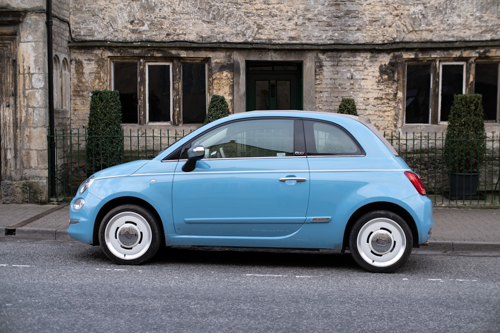

# Auto China 2026 Just Closed. Here Are the Signals African Dealers Should Act On.

**Category:** Product Watch  
**Date:** May 8, 2026  
**Read Time:** 6 min  
**Tag:** Beijing Auto Show 2026 · China EV · Product Watch · Africa Market

---

*Auto China 2026 ran April 24 to May 3 in Beijing — 1,451 vehicles on display, 181 global or Asian premieres, 1.28 million visitors. For African EV importers, it was a forward preview of the sourcing environment through 2027.*

---

## Overview

Auto China 2026 — the Beijing International Automotive Exhibition — closed on May 3 as the largest automotive show of the year by product volume. The exhibit floor was dominated by new energy vehicles: Chinese OEMs brought their most competitive NEV lineups, while established Western brands largely conceded the marquee unveiling space.

For African EV dealers, the show's relevance is not the spectacle — it is the product pipeline signal. Vehicles debuted or confirmed at Beijing in April–May 2026 typically reach African export markets within 12–18 months. This analysis focuses on the strategic trends most relevant to East and West African sourcing, rather than model-by-model specifications that will be confirmed closer to export availability.

---

## The Three Trends That Matter for Africa

### Trend 1: The Sub-$12,000 FOB EV Is Arriving

The clearest signal from Auto China 2026 was continued downward pressure on entry-level EV pricing. Multiple Chinese OEMs — including BYD's Ocean series and several challenger brands — exhibited vehicles positioned below the RMB 80,000 domestic retail threshold.

The commercial implication for African importers: the FOB export price for a credible Chinese BEV with a 300+ km CLTC range is moving toward the $11,000–$13,000 range. This is the price point at which the landed cost in Ethiopia and Nigeria, after taxes and freight, begins to compete directly with equivalent used ICE vehicles on a total cost of ownership basis.

Dealers who built their business case on Chinese EVs being inherently expensive relative to the secondhand Japanese market should revisit that assumption. The arithmetic is shifting.

---

*Auto China 2026's exhibit floor featured the most competitive NEV product mix in the show's history. Entry-level pricing, PHEV range extension, and confirmed RHD production were the three recurring themes across major brand pavilions.*

---

### Trend 2: PHEVs With 100+ km Pure EV Range Are the Infrastructure-Gap Answer

The second major signal: plug-in hybrid vehicles with extended pure electric range dominated the commercial vehicle debut category. Multiple brands exhibited PHEV SUVs and pickups with 100–150 km declared pure EV range alongside conventional petrol backup.

This configuration directly addresses the most common commercial objection to EV adoption in African markets: charging infrastructure uncertainty. A vehicle that covers daily urban mileage on electricity while retaining petrol capability for inter-city routes is not a compromise — it is the product that matches how commercial fleets in Addis Ababa, Nairobi, and Lagos actually operate.

BYD's PHEV lineup — anchored by the Shark 6 already launched in South Africa and Kenya — is the reference product in this category. The show signals that multiple Chinese brands are converging on the same configuration, which means competitive pricing pressure in the PHEV commercial segment is likely by 2027.

### Trend 3: Right-Hand Drive Commitments Are Multiplying

The third trend: more Chinese OEMs made explicit RHD production commitments at Auto China 2026 than at any previous show. South Africa's growing market, Australia's established volumes, and the UK's brand positioning requirements are collectively creating enough RHD demand that OEMs are treating it as a standard production configuration rather than a special order.

For East African dealers (Kenya, Tanzania, Uganda): the RHD vehicle catalogue from China is expanding. Vehicles that were previously available only in converted form — or not available at all — are entering native RHD production. This eliminates the warranty void and safety concerns associated with post-production conversions.

**Practical recommendation**: when contacting Chinese exporters for 2026–2027 sourcing, ask specifically whether the model has confirmed factory RHD production or is a converted unit. The answer to that question has become meaningfully different from what it was 18 months ago.

---

*At Auto China 2026, Chinese OEM booths occupied the majority of premium exhibition space — a reversal from five years ago when Western brands held those positions. The shift reflects where EV product competitiveness now sits.*

---

## What This Means for Your Sourcing Timeline

Auto China 2026 models will begin entering export channels from Q3 2026 onwards for mass-production variants, with new model introductions reaching African importers at scale from Q1–Q2 2027.

Dealers building 2027 sourcing plans should:

**1. Request product roadmaps from your current Chinese suppliers now.** Suppliers with OEM relationships will have access to model launch calendars. Understanding what is coming in Q1–Q2 2027 allows you to manage existing inventory without being caught holding outdated stock when new models arrive.

**2. Ask about RHD production status for any model you plan to source in volume.** The Beijing show created multiple new RHD commitments — get written confirmation from your supplier of factory RHD availability before committing to an order.

**3. Evaluate PHEV configurations seriously if your market has charging infrastructure gaps.** The Auto China 2026 PHEV lineup signals that this configuration will be widely available and competitively priced by 2027. For markets like Ethiopia and inland East Africa where DC fast charging is sparse, a PHEV with 100+ km EV range may outperform a pure BEV on actual commercial utility.

---

## A Note on Specific Model Specifications

Trade press coverage of Auto China 2026 includes detailed specifications for numerous debuted models. Where those specifications are from OEM press releases and have been independently confirmed by multiple automotive media outlets, they can be used for planning purposes.

However, specifications announced at a motor show — particularly for models that are still in production ramp-up — frequently change before export variants reach your market. **Do not finalise purchase commitments based on show-floor specifications alone.** Request the confirmed export variant spec sheet from your supplier when the model enters production, and verify RHD configuration, battery warranty terms, and after-sales documentation before signing.

---

## Sources

- Auto China 2026 — official exhibition statistics (April 24–May 3, 2026): 1,451 vehicles, 181 premieres, 1.28M visitors
- CnEVPost — Auto China 2026 brand-by-brand coverage (April–May 2026)
- CarNewsChina — Beijing Auto Show 2026 floor reports (April–May 2026)
- BYD official — Shark 6 South Africa and Kenya launch documentation (2025)
- CATL — Freevoy PHEV battery system specifications (2025–2026)

---

*Published by Evexport Intelligence Desk · May 2026*
