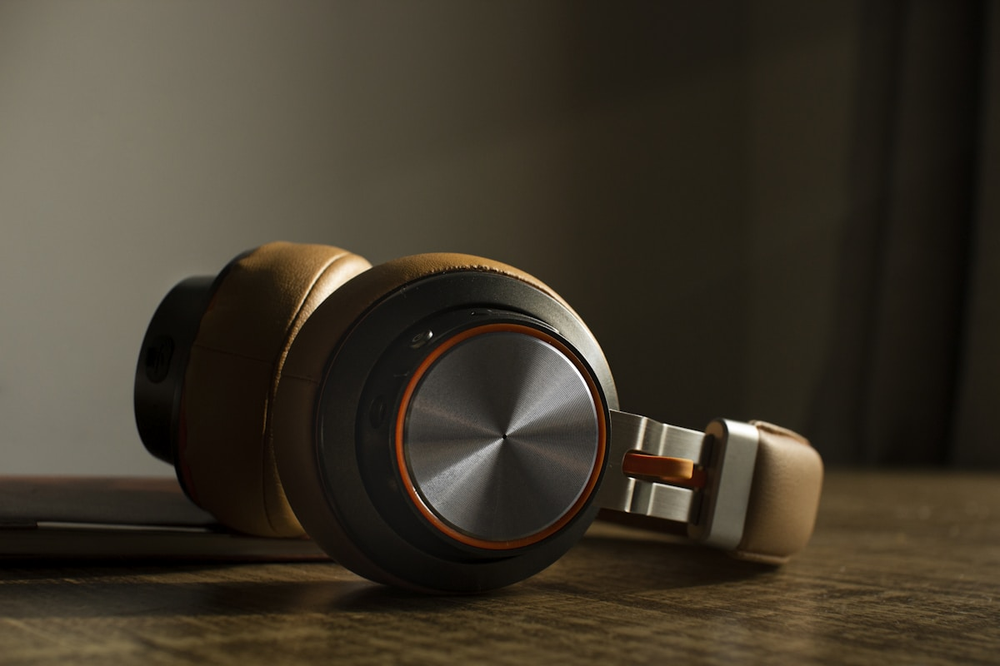
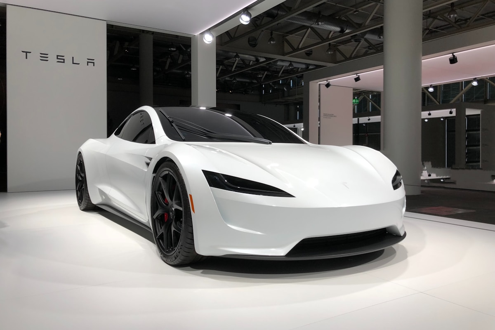
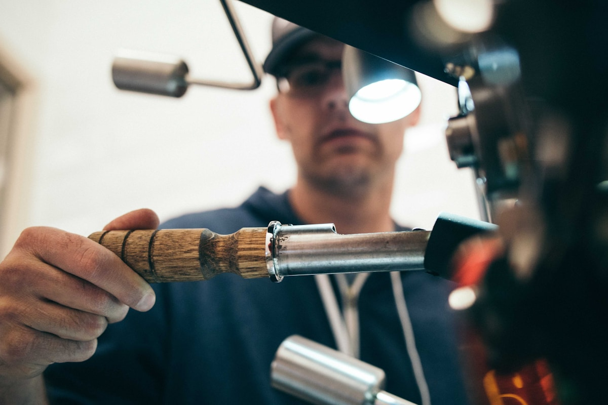

# CATL's 2026 Tech Day Changed the Battery Roadmap. What African Dealers Need to Know.

**Category:** Product Watch  
**Date:** May 2, 2026  
**Read Time:** 7 min  
**Tag:** CATL · Battery Technology · Fast Charging · Africa EV Market

---

*CATL held its 2026 Tech Day on April 21, 2026 — announcing six technologies across charging speed, energy density, sodium-ion chemistry, and battery swapping that will define the next generation of Chinese EVs entering African markets.*

---

## Overview

On April 21, 2026, CATL — the world's largest battery manufacturer, supplying cells to BYD, Geely, NIO, Li Auto, and most of the major Chinese EV brands — held its annual Technology Day in Ningde, China.

The announcements were not incremental. Across six product lines, CATL laid out a technology roadmap that will filter into vehicles reaching African markets from late 2026 through 2028. For dealers sourcing Chinese EVs, this briefing matters: it defines which battery technologies to look for, which specifications are now achievable, and which vehicles will carry meaningful charging and range advantages over the competition.

---

## Six Announcements, Translated for African Dealers

### 1. Shenxing 3rd Generation: 6-Minute Charging Is Here

CATL's Shenxing supercharging battery reached its third generation at Tech Day 2026. The headline specification: a charge from 10% to 80% in **6 minutes** under optimal conditions, enabled by a new electrolyte formulation and cell architecture that reduces internal resistance at ultra-high charge rates.

For context: the 2nd-generation Shenxing (launched in late 2023) achieved 10-80% in approximately 10 minutes. The 3rd generation closes the gap with petrol refuelling in a way that changes the commercial calculus for fleet operators.

The practical implication for African market deployment: **vehicles equipped with 3rd-gen Shenxing cells can charge in the time it takes to conduct a driver handover** at a taxi rank or a logistics hub delivery stop — a genuine operational change, not a showroom spec.

Which vehicles will carry it: BYD's 2026 generation flagship models, several Geely/Zeekr premium models, and NIO vehicles from H2 2026 onwards. Expect these specifications to appear in Africa-facing models from Q1 2027.

---

*The 3rd-generation Shenxing battery's 6-minute 10-80% charge capability is designed for vehicles using 400A+ chargers — still rare in Africa, but relevant for fleet depot and fast-charger investment planning.*

---

### 2. Qilin 3rd Generation: Thermal Performance for Hot Climates

The 3rd-generation Qilin battery's headline specification is a **15C peak discharge rate** — the highest ever achieved in a mass-production automotive cell. This matters less for range than for performance under stress: high-temperature fast charging, sustained hill climbing, and heavy payload operation.

For equatorial African markets — where ambient temperatures regularly exceed 35°C and battery thermal management is a real operational concern — the Qilin 3rd gen's improved thermal architecture addresses a genuine market-specific challenge. Chinese EVs have occasionally received criticism for reduced range and charging speed in high-temperature environments; the Qilin's chemistry improvements are explicitly designed to reduce this degradation.

### 3. Condensed Matter Battery: 350 Wh/kg, 1,500 km

The most ambitious announcement was the **condensed matter battery** — a semi-solid electrolyte technology that achieves **350 Wh/kg** at the cell level, enabling vehicles with ranges exceeding **1,500 km** on a single charge.

For perspective: current mainstream LFP batteries achieve roughly 150-180 Wh/kg. Current NCM batteries achieve 250-280 Wh/kg. Condensed matter technology sits above everything in the current production landscape.

CATL confirmed production ramp-up for the condensed matter battery is underway, initially targeting premium segments and aviation applications, before broadening to commercial automotive in 2027–2028.

For African dealers, this technology is **not immediately actionable** — it will appear first in premium Chinese models (Yangwang U8, NIO ET9) at price points above the Africa-focused market. The relevance is strategic: watch for condensed matter specifications to appear in mid-range vehicles by 2028, at which point the range anxiety argument against EVs in markets with sparse charging infrastructure largely dissolves.

---

*CATL's condensed matter battery achieves 350 Wh/kg — roughly twice the energy density of standard LFP cells. Production is ramping in 2026 for premium segments, with broader automotive application from 2027.*

---

### 4. Naxtra Sodium-Ion: Commercial Production Confirmed

CATL confirmed that its **Naxtra sodium-ion battery** has entered commercial mass production. Sodium-ion chemistry is significant for African markets for a specific reason: it eliminates lithium, cobalt, and nickel from the cell chemistry, using abundant and geographically diversified raw materials.

The commercial implication: sodium-ion vehicles are structurally less exposed to lithium price volatility and supply chain disruptions. For buyers concerned about long-term parts costs, a sodium-ion vehicle has a simpler raw material base.

The first vehicles using Naxtra sodium-ion cells are expected in the entry-level segment from Chinese manufacturers in H2 2026. CATL positioned these cells as optimal for **short-range urban and commercial use** — the precise segment that dominates African EV market demand.

For Africa-facing dealers: **sodium-ion vehicles are a category to watch** in the sub-$15,000 import price range from 2027 onwards. They will offer a lower-cost, simpler-chemistry alternative to LFP, particularly relevant for markets where after-sales simplicity matters.

### 5. Freevoy 2nd Generation: 500 km EV-Only Range in PHEVs

CATL's Freevoy system powers plug-in hybrid vehicles (PHEVs) by acting as a large-capacity supplementary battery integrated with the vehicle's combustion powertrain. The 2nd-generation Freevoy achieves **500 km of pure EV-only range** — a figure previously achievable only in full BEVs.

This is directly relevant to African markets where charging infrastructure remains uneven. A PHEV with 500 km EV-only range can operate in full-electric mode in urban areas — where most kilometres accumulate — while retaining combustion capability for inter-city routes where charging is not yet reliable.

The vehicles most likely to carry Freevoy 2nd gen in Africa-facing configurations: BYD Shark 6 successor variants, Chery crossover PHEVs, and several Geely brands targeting the 2027 Africa export push. The BYD Shark (already launched in South Africa and Kenya) uses Freevoy 1st generation — a 2nd-gen Shark derivative with 500 km EV range would substantially change the commercial vehicle calculus for Ethiopian and Kenyan markets.

### 6. Ultra-Swap: 4,000 Stations by End of 2026

CATL's battery swapping network — **Ultra-Swap** — is targeting **4,000 operational swap stations across China by end of 2026**, following a confirmed deal with several commercial fleet operators to use swappable cell packs rather than fixed-battery EVs.

Battery swapping is relevant context for African dealers for a structural reason: in markets where charging infrastructure is thin, swapping-capable vehicles shift the charging constraint from the operator to the network operator. In Ethiopia, Kenya, and Nigeria, the economics of shared swap networks for commercial fleets are significantly more attractive than individual vehicle charging.

CATL's Ultra-Swap is a China-first deployment, but the commercial model is being watched by African urban mobility investors. NIO already operates battery swap stations in several locations outside China. It is reasonable to anticipate swap-capable vehicles becoming available for African commercial fleet procurement from 2027.

---

## The Africa-Relevant Summary

 > **注：** "Africa Timeline"列为编辑基于CATL技术日公告及行业出口周期规律的估算，非CATL官方非洲市场发布计划。实际到货时间受OEM出口排期、RHD认证及区域分销协议影响，建议向供应商确认具体车型上市时间。

| Technology | What It Achieves | Africa Timeline | Priority for Dealers |
|------------|-----------------|-----------------|---------------------|
| Shenxing 3rd Gen | 6-min charge (10-80%) | Q1 2027 in imports | High — fleet ops impact |
| Qilin 3rd Gen | 15C peak, heat performance | Q2 2027 | Medium — equatorial markets |
| Condensed Matter | 350 Wh/kg, 1,500 km | 2028+ | Watch — mid-range in 3 years |
| Naxtra Sodium-Ion | Lithium-free, mass production | H2 2026 entry models | High — cost stability |
| Freevoy 2nd Gen | 500 km EV-only in PHEVs | 2027 Africa models | Very high — infra gap solution |
| Ultra-Swap | 4,000 stations (China) | Watch — export TBD | Medium — fleet model signal |

The most immediately actionable finding: **Naxtra sodium-ion and Freevoy 2nd gen** are the two technologies most relevant to the current African market realities — the first because it reduces long-run cost exposure, the second because it directly addresses the charging infrastructure gap that remains the primary commercial objection to EV fleet adoption.

---

## Sources

- CATL Official — *2026 Technology Day press release* (April 21, 2026)
- CnEVPost — *"CATL Tech Day 2026: Shenxing 3rd Gen, Naxtra Sodium-Ion, Condensed Matter Battery"* (April 2026)
- Electrive.com — *"CATL presents 2026 battery technology roadmap"* (April 2026)
- InsideEVs — *"CATL 2026 Tech Day: Everything Announced"* (April 2026)
- CleanTechnica — *"CATL's Freevoy 2nd Generation: 500 km EV range in PHEVs"* (April 2026)

---

*Published by Evexport Intelligence Desk · May 2026*
