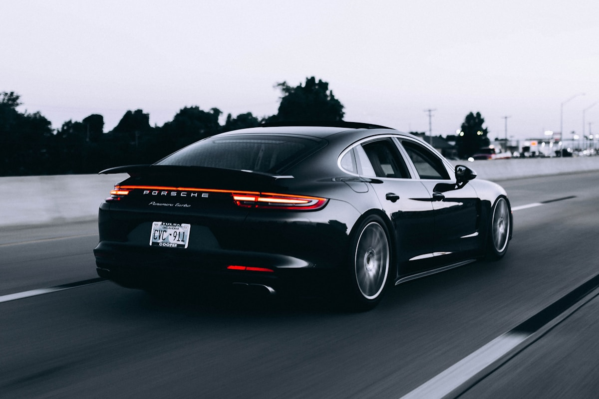
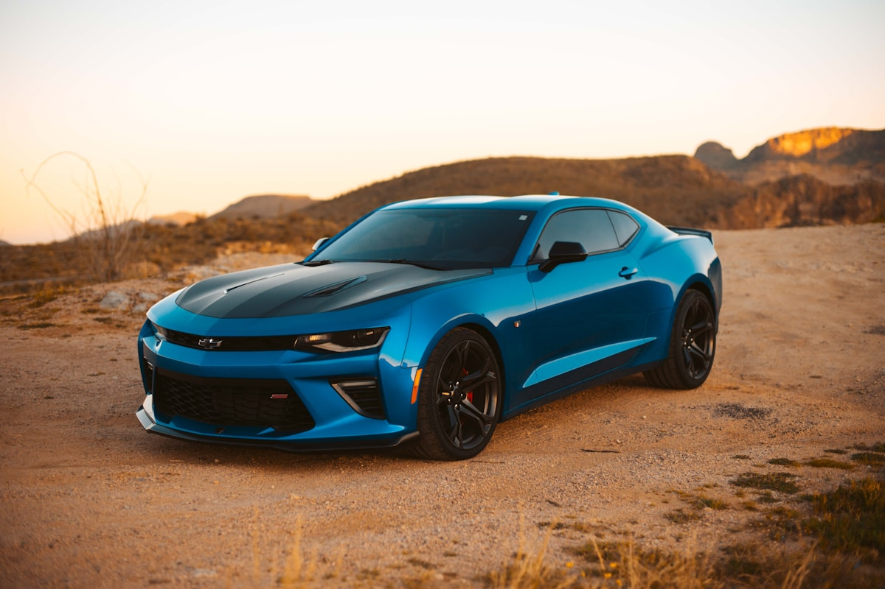

# Chinese Electric Pickups Are Coming to East Africa. Here's What Matters.

**Category:** Product Watch  
**Date:** April 15, 2026  
**Read Time:** 6 min  
**Tag:** Electric Pickup · BYD Shark · Chery · Ethiopia Commercial · Kenya

---

*The pickup truck is East Africa's most commercially critical vehicle segment — used for logistics, agriculture, NGO operations, and commercial passenger transport. Chinese electric pickups are now arriving in the market. The commercial case is strong in specific use cases and weak in others.*

---

## Overview

East Africa runs on pickup trucks. The Toyota Hilux has defined the commercial vehicle category for 40 years across Kenya, Tanzania, Ethiopia, and Uganda — used for everything from farm-to-market produce delivery to NGO field operations to informal passenger transport (matatu feeder routes). Any vehicle challenging the Hilux in this segment needs to answer the same questions: Can it handle the roads? Can it carry the load? Can you get parts?

Chinese electric pickups are now entering this conversation. The BYD Shark 6 launched in South Africa in April 2025 and in Kenya later the same year. The 2026 Beijing Auto Show hinted at additional Chinese PHEV and full BEV pickup entrants. This analysis evaluates the commercial case — and the limitations — for the East African market.

---

## Why a Pickup Truck Can't Be a Pure BEV Yet

For urban taxis and short-route commercial vehicles, a pure BEV is operationally viable in markets like Addis Ababa and Nairobi, where daily distances are predictable and the vehicle returns to a charging point nightly.

Pickups operate differently. They are used for inter-city routes, rural supply chains, and unpredictable-range commercial tasks. A commercial pickup that cannot reliably complete a Nairobi-to-Nakuru run (100 km each way) or a Mombasa-to-Malindi goods delivery (120 km each way) without range anxiety is not commercially viable for the majority of East African use cases.

This is why every Chinese electric pickup currently viable for East African deployment is a **plug-in hybrid (PHEV)** — not a pure BEV. The PHEV architecture provides electric operation in urban conditions where fuel cost savings are maximised, with petrol backup for the range-variable long-distance use that defines commercial pickup use.

---

*The BYD Shark 6 PHEV — launched in South Africa (April 2025) and Kenya (2025) — is the most commercially relevant Chinese electric pickup in East Africa as of 2026. Its 100 km pure EV range covers urban use; its petrol engine covers inter-city routes without charging infrastructure.*

---

## BYD Shark 6: The Current Market Leader

The BYD Shark 6 is a dual-cab pickup powered by a PHEV drivetrain integrating a 1.5T turbocharged petrol engine with a Freevoy battery system providing 100 km of pure electric range.

**Key specifications:**
- Pure EV range: 100 km CLTC
- Total range (EV + petrol): 840 km
- Payload: 1,000 kg
- Towing capacity: 4,500 kg
- Ground clearance: 224 mm
- Drive system: 4WD available

**South Africa and Kenya deployment (2025 data):**
BYD South Africa confirmed positive initial reception in the pickup segment, with the Shark targeting fleet operators running predictable urban/suburban routes. Early Kenya adopters have used the Shark in mixed urban commercial applications.

**Pricing (indicative):**
- South Africa retail: approximately R950,000–R1,050,000 (depending on variant)
- Kenya (estimated 2025 retail): approximately KES 4.2–4.8 million
- Ethiopian landed cost (LHD): will be higher per unit given tax structure — estimated ETB 2.5–3.2 million for a standard Shark imported without duty exemptions under Directive 1006/2024

**For Ethiopia specifically**: The Shark is a LHD vehicle in its primary production configuration, which is compatible with Ethiopia's right-hand traffic system. A landed Shark in Addis Ababa faces Ethiopia's full EV tax stack — no ICE exemption applies to the petrol component, but classification as a PHEV may attract different rates than a pure BEV depending on current ERCA interpretation. Confirm classification with a customs broker before purchase commitment.

---

## Other Chinese Electric Pickups to Watch

### GWM/Haval (Great Wall Motors) — Upcoming EV Pickup

GWM — which already has an established dealer presence in South Africa and a growing presence in East Africa — has announced intentions to bring electric pickup variants of its commercial truck range to African markets. No confirmed 2026 launch date as of the Beijing Auto Show, but the GWM Poer PHEV is a relevant product to monitor.

### BYD Shark Second Generation

BYD confirmed at the 2026 Beijing Auto Show that a successor to the Shark 6 is in development, targeting a 2027 production start. The 2nd-gen Shark is expected to incorporate CATL's Freevoy 2nd-generation battery system, which achieves 500 km of pure electric range in PHEV configurations. A Shark with 500 km EV range would represent a substantially different commercial proposition — handling most inter-city East African routes on electricity alone.

---

## The Commercial Case: When It Works, When It Doesn't

**Electric pickup is commercially compelling when:**
- Operating pattern is primarily urban (daily mileage under 150 km, overnight return to charging point)
- Fleet operator can install depot charging (3-phase AC sufficient for overnight charging)
- Route includes significant highway driving where PHEV can pre-condition battery for urban segments

**Electric pickup is not yet commercially compelling when:**
- Routes require inter-city travel without charging access (the petrol backup mitigates range risk but increases complexity)
- Parts and service for the electric drivetrain components are not locally available
- Buyer is replacing a working Hilux at an ICE price point — the price premium requires a financial case that total cost of ownership analysis must justify

For Ethiopian commercial operators: the primary constraint is not the product — it is the charging infrastructure and the after-sales service access for the electric drivetrain. Operators considering the Shark should budget for their own depot charging installation and identify a competent EV technician before committing.

---

## What to Ask Before Buying a Chinese Electric Pickup

1. **What is the warranty coverage for the PHEV battery specifically?** Some exporters' warranty terms cover the battery for 8 years / 120,000 km in domestic China but offer shorter coverage on export sales.

2. **Are parts — specifically the high-voltage battery pack and power electronics — stocked locally, or are they China-order items?** A high-voltage battery replacement from China takes 6–12 weeks. During that period, your PHEV is an ICE-only vehicle.

3. **Is the ground clearance and suspension configuration appropriate for unpaved roads in your specific operating area?** The Shark's 224 mm ground clearance is adequate for most graded roads; extreme off-road applications should be evaluated specifically.

4. **Does the RHD requirement apply?** Kenya and Tanzania require RHD — the BYD Shark has RHD variants. Ethiopia, Nigeria, and West Africa do not require RHD.

---

## Sources

- BYD South Africa — Shark 6 launch announcement and specifications (April 2025)
- CnEVPost — *"BYD Shark 6 launches in South Africa: specs and pricing"* (April 2025)
- CarNewsChina — *"BYD Shark second generation confirmed for 2027"* (May 2026)
- CATL — Freevoy 2nd generation specifications, 2026 Tech Day
- GWM South Africa — product and network updates (2025–2026)
- Ethiopian Customs Authority / ERCA — PHEV classification guidance

---

*Published by Evexport Intelligence Desk · April 2026*
