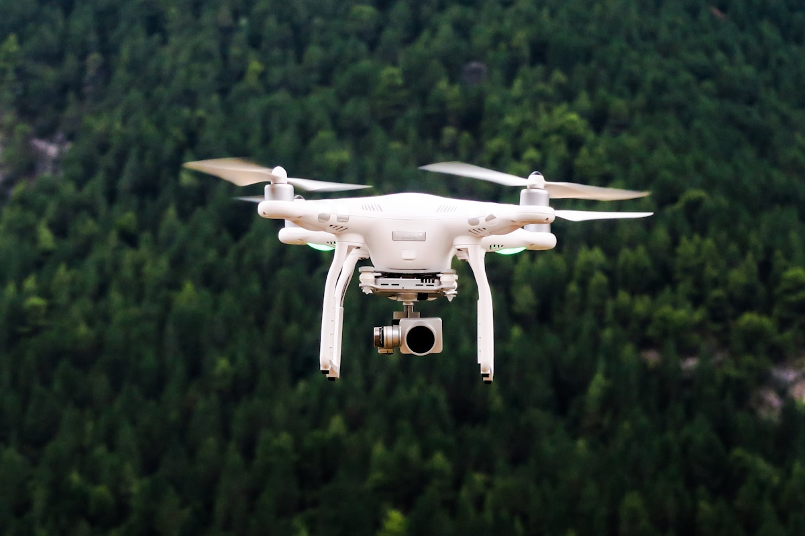
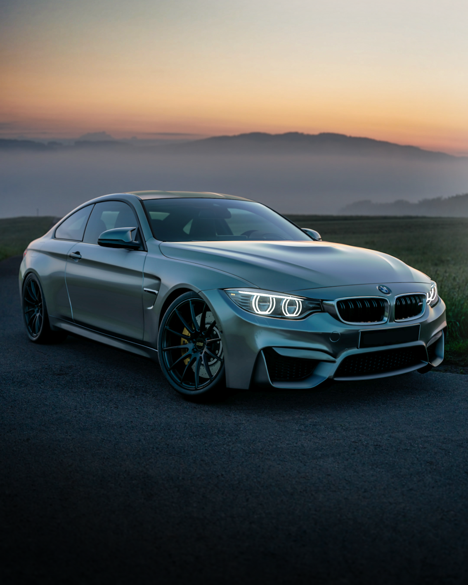
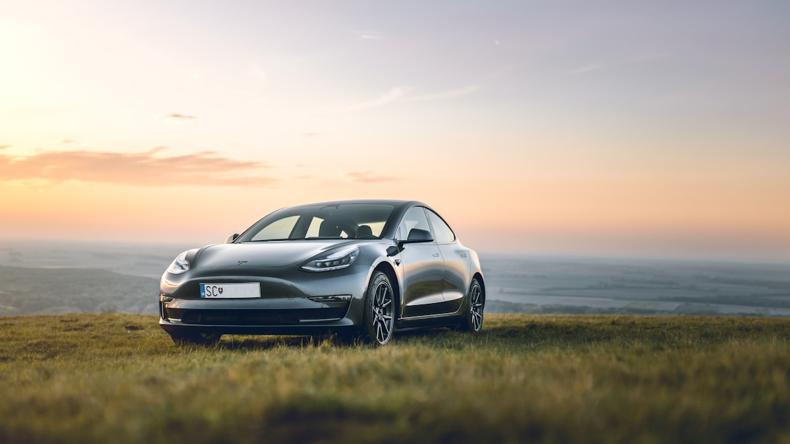

# The 5 Best Chinese EVs for African Markets in 2026

**Category:** Sourcing Intelligence  
**Date:** May 12, 2026  
**Read Time:** 8 min  
**Tag:** Chinese EV Guide · Africa 2026 · BYD · Chery · Product Selection

---

*This guide covers the five Chinese EVs that offer the strongest fit for African operating conditions in 2026 — evaluated on price, range, after-sales support availability, RHD compatibility, and infrastructure tolerance.*

---

## Overview

"Which Chinese EV should I import?" is the defining question for African dealers in 2026. There are now more than 40 Chinese EV brands producing models nominally available for export — but the number that offer realistic fit for African operating conditions, credible after-sales support, and pricing that makes commercial sense is considerably smaller.

This selection evaluates Chinese EVs on five criteria relevant to African market realities:
1. **Price competitiveness** (FOB export pricing)
2. **Real-world range** in high-temperature conditions
3. **After-sales parts accessibility** in or near the destination market
4. **RHD availability** (where relevant)
5. **Infrastructure tolerance** — how the vehicle performs with intermittent or DC fast-charge-scarce infrastructure

The 2026 Beijing Auto Show (April 24–May 3) is the freshest data point for upcoming models; this guide incorporates those announcements alongside confirmed production vehicles available now.

---

## 1. BYD Atto 3 (Yuan Plus) — The Proven All-Rounder

**Segment**: Compact SUV  
**FOB export price range**: $18,000–$22,000 USD  
**Range (WLTP)**: 420 km  
**RHD available**: Yes (South Africa, Australia, UK)

The Atto 3 is the closest thing to a proven commodity in the African Chinese EV market. It launched in South Africa in late 2022, has been sold in Kenya, and has accumulated enough operating hours in East African conditions to give dealers and fleet buyers a meaningful data set on real-world performance.

Key advantages:
- BYD's most documented Africa-facing model for reliability data
- Fully native RHD available — no conversion required for Kenya, Tanzania, South Africa
- Extensive 420 km WLTP range; estimated 300-330 km in mixed East African driving conditions
- LFP blade battery with proven thermal stability in equatorial environments

Limitations:
- Not the cheapest option; more competitive pricing available in the pure urban segment
- BYD's official after-sales network in Sub-Saharan Africa (outside South Africa) remains thin

**Best for**: Fleet operators and commercial buyers in Kenya and South Africa who want a documented, relatively proven vehicle. Dealers building a starter BYD-based portfolio.

---

*The strongest Chinese EV options for Africa in 2026 span urban hatchbacks, compact SUVs, and PHEV pickups — each addressing a distinct segment of the market. No single vehicle is ideal for all African markets simultaneously.*

---

## 2. BYD Seagull — Best Value Urban EV

**Segment**: Compact urban hatchback  
**FOB export price range**: $11,500–$13,500 USD  
**Range (CLTC)**: 305 km (standard) / 405 km (long range)  
**RHD available**: No — LHD only as of mid-2026

The Seagull is the most price-competitive credible BEV available from China for export. Its low FOB price makes it accessible as a fleet entry vehicle — when Ethiopian and Nigerian taxi operators run the landed cost and TCO calculations, the Seagull consistently comes out as the vehicle that closes the commercial case for EVs in urban fleet applications.

Key advantages:
- Lowest FOB price of any credible Chinese OEM BEV
- LFP Blade Battery — no thermal runaway risk; simpler chemistry for service markets with limited EV technical expertise
- Real-world range of ~230-260 km in urban conditions — matches typical daily mileage for Addis Ababa and Lagos commercial use
- Strong structural sales case in high-fuel-cost markets (Ethiopia, Nigeria)

Limitations:
- LHD only — not suitable for Kenya, Tanzania, South Africa without conversion (which voids warranty)
- No BYD official after-sales network in most Sub-Saharan markets
- Post-180-day rule: ensure OEM documentation for recently manufactured units

**Best for**: Ethiopian and Nigerian fleet buyers; ride-hailing operators; market-entry price anchoring in LHD markets.

## 3. BYD Shark 6 — The Infrastructure Gap Solution

**Segment**: PHEV pickup truck  
**FOB export price range**: $30,000–$38,000 USD  
**EV range (CLTC)**: 100 km pure electric  
**Total range (EV + petrol)**: 840 km  
**RHD available**: Yes (South Africa, Kenya — launched 2025)

The Shark 6 is the most strategically important vehicle on this list for East African markets. It is the only product that simultaneously addresses:
- The utility vehicle preference of East African commercial buyers (pickup truck body)
- The charging infrastructure gap (100 km pure EV for urban use, petrol for inter-city)
- The RHD requirement of Kenya and Tanzania

The Shark's dual-mode capability means buyers in markets with two fast chargers in the entire capital city (such as Addis Ababa as of 2025) can still operate primarily on electricity in urban conditions while retaining full range capability for any journey.

South Africa and Kenya launches in 2025 have generated early sales data: the Shark has been particularly well-received by fleet operators running mixed urban/inter-city routes.

**Best for**: Kenya and Tanzania commercial operators; Ethiopian buyers who can access LHD; fleet operators with mixed urban/rural route profiles.

---

*The BYD Shark's 100 km pure EV range handles urban daily driving on electricity, while the petrol engine covers inter-city distances where charging infrastructure is absent. For East African commercial operators, it is the most operationally practical EV available in 2026.*

---

## 4. Chery Tiggo 7e PHEV — Best for Unstable Grid Markets

**Segment**: Compact SUV PHEV  
**FOB export price range**: $19,000–$24,000 USD  
**EV range (CLTC)**: 75–100 km pure electric  
**Total range**: 700+ km  
**RHD available**: Select markets (confirm before order)

Chery's Tiggo 7e PHEV addresses the same infrastructure gap as the BYD Shark, but in a compact SUV form factor at a significantly lower price point. For buyers who cannot stretch to the Shark's price but need petrol backup capability, the Tiggo 7e PHEV sits in a valuable middle position.

Chery's key Africa advantage over BYD: established ICE vehicle trade relationships in Ethiopia, Kenya, Nigeria, and Ghana mean that Chery importers often have existing dealer infrastructure, customer relationships, and basic service capability — reducing the cold-start challenge of introducing a new brand.

Key advantages:
- Lower price than Shark at similar infrastructure-tolerance proposition
- Chery's existing Africa trade relationships ease market entry
- Respectable cargo volume for commercial use
- PHEV chemistry simpler to service than pure BEV in markets with limited EV technical training

Limitations:
- Smaller EV-only range than Shark at similar pure electric capacity
- RHD availability varies by model year and market — confirm with exporter

**Best for**: Ethiopian, Nigerian, and Ghanaian buyers seeking an urban/inter-city PHEV at competitive pricing. Dealers with existing Chery ICE relationships transitioning to electrification.

## 5. SAIC MG4 — Best After-Sales Network

**Segment**: Compact hatchback / sport  
**FOB export price range**: $18,000–$22,000 USD  
**Range (WLTP)**: 350–520 km depending on variant  
**RHD available**: Yes (South Africa, UK, Australia)

The MG4 is the strongest choice when after-sales parts supply chain is the primary selection criterion. SAIC operates global after-sales distribution centres in Amsterdam and Paris, with established parts routes into South Africa. For dealers who have experienced the pain of waiting 6–12 weeks for a spare part from China, the MG4's more developed parts pipeline is a meaningful differentiator.

The brand carries residual consumer recognition from its British heritage, which assists sales in South Africa and increasingly in Kenya, where buyers who are familiar with the MG brand from ICE-era imports respond more quickly to the EV pitch.

Limitations:
- Higher price than Seagull for buyers primarily motivated by entry cost
- SAIC/MG does not have the commercial fleet track record of BYD in Africa

**Best for**: South African dealers; Kenya dealers targeting private buyers; importers for whom parts supply lead time is the dominant risk factor.

---

## Quick Reference Comparison

| Vehicle | FOB Price | RHD | EV Range | Infrastructure Tolerance | Best Market |
|---------|-----------|-----|----------|------------------------|-------------|
| BYD Atto 3 | $18–22K | Yes | 300–330 km | Moderate | Kenya, SA |
| BYD Seagull | $11.5–13.5K | No | 230–260 km | Moderate | Ethiopia, Nigeria |
| BYD Shark 6 | $30–38K | Yes | 100 km EV + petrol | High (PHEV) | Kenya, ET, TZ |
| Chery Tiggo 7e PHEV | $19–24K | Varies | 75–100 km EV + petrol | High (PHEV) | ET, NG, GH |
| SAIC MG4 | $18–22K | Yes | 300–450 km | Moderate | SA, Kenya |

---

## Sources

- BYD South Africa — Atto 3, Shark 6, and Dolphin product specifications (2025–2026)
- BYD official — Seagull domestic and export specifications (2026)
- Chery South Africa — Tiggo 7e PHEV product announcement (2025–2026)
- SAIC (MG) South Africa — MG4 product specification and after-sales documentation (2025)
- CnEVPost — Chinese EV export pricing data (2025–2026)
- Africa E-Mobility Alliance — *Africa E-Mobility Report 2025*

---

*Published by Evexport Intelligence Desk · May 2026*
