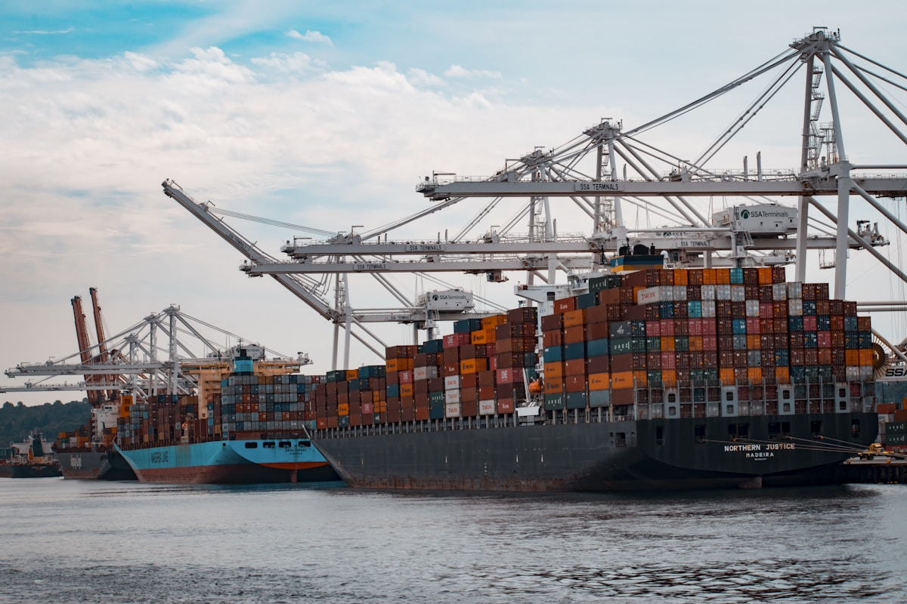

# Mombasa, Djibouti, or Dar es Salaam? The East Africa Port Guide for EV Importers

**Category:** Sourcing Intelligence  
**Date:** March 5, 2026  
**Read Time:** 7 min  
**Tag:** Mombasa · Djibouti · Dar es Salaam · Port Logistics · East Africa

---

*East Africa has three major vehicle import ports — Mombasa, Djibouti, and Dar es Salaam. Each serves a different geographic hinterland and carries different cost, clearance time, and infrastructure characteristics. The right port for your shipment depends on the destination country, shipment method, and your timeline.*

---

## Overview

The choice of East African port is not simply a logistics question — it determines your duty liability jurisdiction, your customs clearance timeline, your road transit costs to destination, and your exposure to port congestion delays. For EV importers sourcing from China, all three major East African vehicle ports are relevant, but for different markets and use cases.

This guide covers the operational characteristics of Mombasa, Djibouti, and Dar es Salaam as of early 2026 — including the specific advantages and limitations of each for Chinese EV imports.

---

## Mombasa, Kenya: East Africa's Dominant Vehicle Gateway

**Mombasa's Kilindini Harbour** is the largest port on the East African coast by volume and the primary import gateway for Kenya, Uganda, Rwanda, Burundi, Eastern Democratic Republic of Congo, and South Sudan. Approximately 30 million tonnes of cargo pass through annually.

For vehicle imports specifically, Mombasa handles both RoRo and container traffic through dedicated vehicle-processing zones at the Container Terminal and the adjacent RoRo berth.

### Mombasa Vehicle Import Characteristics

| Factor | Detail |
|--------|--------|
| RoRo service | Regular; multiple carriers including Grimaldi, MOL, and K-Line |
| Container handling | High-volume; crane capacity allows rapid container throughput |
| Typical clearance time | 5–10 working days for documentation-complete shipments |
| Peak congestion period | October–December (pre-Christmas import surge) |
| Storage (Free Time) | 7 days free storage; demurrage rates escalate steeply after |
| Pre-clearance option | Yes — documents can be processed before vessel arrival |

**Customs Framework**: Kenya Revenue Authority (KRA) processes all Mombasa vehicle imports. The Single Customs Territory (SCT) arrangement with Uganda, Rwanda, and Tanzania allows goods to be cleared once at Mombasa and transit directly to inland destinations under bond without re-clearance at the border.

**Advantage for Kenya-destined shipments**: Mombasa is the lowest-cost East African port for Kenya-bound vehicles by road transit cost. The Nairobi ICD (Inland Container Depot) allows container clearance closer to the buyer, reducing the final-mile cost.

---

*Mombasa's Kilindini Harbour — the largest port by volume on the East African coast — handles RoRo and container vehicle traffic for Kenya and six inland markets. The SCT arrangement allows single-clearance transit to Uganda, Rwanda, and beyond.*

---

## Djibouti: The Only Gateway for Ethiopia, and a Regional Hub

**Djibouti Port** — specifically the Doraleh Multi-Purpose Port (DMPP) and the Doraleh Container Terminal (DCT) — serves as the exclusive import gateway for Ethiopia, which is the world's most populous landlocked country.

All Ethiopian imports transit through Djibouti. There is no viable alternative: Eritrea's Massawa port (Ethiopia's former gateway) has been closed to Ethiopian trade since the 1998–2000 Eritrea-Ethiopia war, and Somalia's Berbera port (used occasionally) lacks the infrastructure for vehicle import volumes.

### Djibouti Vehicle Import Characteristics

| Factor | Detail |
|--------|--------|
| RoRo service | Dedicated RoRo berth at DMPP; services from Grimaldi, Höegh, PCTC operators |
| Container handling | Doraleh Container Terminal (managed by DP World); high-capacity cranes |
| Ethiopia clearance process | Ethiopian Customs Authority liaisons stationed at Djibouti; customs pre-clearance available |
| Transit to Addis Ababa | Road: 900 km, 1–3 days. Rail: Addis-Djibouti Railway (operational but limited capacity) |
| Typical total transit (port to Addis) | 7–14 days port clearance + 2–3 days road = 10–17 days |
| Storage (Free Time) | 7 days at DCT; DMPP may vary by operator |
| Red Sea surcharges (2025–2026) | Elevated due to Houthi disruptions; add $200–$400 per vehicle depending on routing |

**Addis-Djibouti Railway**: The 756 km electrified railway connecting Djibouti port to Addis Ababa is operational and used for containerised freight. For vehicle imports, container railway transit is available but less common than road trucking, which offers more flexible scheduling and door-to-dealer delivery.

**The Ethiopia Customs Process at Djibouti**: Ethiopian customs operates a liaison presence at Djibouti port. Documents can be pre-submitted through Ethiopia's ASYCUDA system before vessel arrival, enabling faster release. Well-prepared importers with clean documentation achieve clearance within 7 working days.

---

*Djibouti's Doraleh Multi-Purpose Port — the exclusive gateway for Ethiopian vehicle imports. The 900 km Addis-Djibouti road corridor and the electrified railway provide the two transit options after port clearance.*

---

## Dar es Salaam: Tanzania and the Southern Corridor

**Dar es Salaam Port** (Tanzania Ports Authority) is the primary import gateway for Tanzania, Zambia, Malawi, and parts of Southern DRC and Mozambique. It handles the second-largest cargo volume of the three ports discussed here.

### Dar es Salaam Vehicle Import Characteristics

| Factor | Detail |
|--------|--------|
| RoRo service | Available but less frequent than Mombasa; some carriers bypass DSM for Mombasa |
| Container handling | High-volume; ongoing infrastructure investment as of 2025–2026 |
| Clearance time | 7–14 working days; congestion has been a recurring issue |
| Tanzania Revenue Authority | TANCIS system for customs declaration |
| Storage | 7 days free; demurrage escalates after |
| Transit to Lusaka (Zambia) | ~1,900 km; 3–5 days road |

**The Northern Corridor alternative**: Tanzania-bound importers sometimes prefer Mombasa under the EAC SCT arrangement, transiting through Kenya to Tanzania under bond. This is counter-intuitive geographically but can be faster in periods of Dar es Salaam congestion.

---

## Port Selection Decision Guide

| If your destination is... | Recommended port | Notes |
|--------------------------|-----------------|-------|
| Ethiopia | Djibouti (no alternative) | All Ethiopian imports via Djibouti |
| Kenya (Nairobi) | Mombasa | Lowest cost; direct SCT clearance |
| Uganda (Kampala) | Mombasa | SCT bond transit; competitive vs. Dar |
| Rwanda (Kigali) | Mombasa | 1,300 km road to Kigali from Mombasa under SCT |
| Tanzania (Dar es Salaam) | Dar es Salaam | Direct clearance; Mombasa as backup |
| Zambia (Lusaka) | Dar es Salaam | Southern Corridor; some use Durban |
| DRC (Eastern) | Dar es Salaam or Mombasa | Via Rwanda or Tanzania |

---

## Red Sea Routing Note (2025–2026)

Since the escalation of Houthi attacks on Red Sea shipping in late 2023, several major carriers have been routing via the Cape of Good Hope rather than the Suez Canal. This adds approximately **14–21 days** to China–East Africa transit times and **$200–$500 USD per vehicle** in additional freight cost depending on the carrier and route.

As of mid-2026, some carriers have resumed partial Red Sea routing; others maintain Cape routing. When booking China–East Africa freight, confirm with your freight forwarder which routing is in use for your specific sailing — this affects your ETA calculation materially.

---

## Sources

- Kenya Ports Authority — Kilindini Harbour vehicle import procedures and statistics (2025)
- Djibouti Ports & Free Zones Authority — Doraleh Multi-Purpose Port specifications (2025)
- Tanzania Ports Authority — Dar es Salaam port infrastructure and procedures (2025)
- Ethiopian Customs Authority — ASYCUDA system and pre-clearance procedures
- UNCTAD — *Review of Maritime Transport 2025* (East Africa port traffic data)
- Freightos — Red Sea disruption impact on East Africa shipping lanes (2024–2025)

*本文港口数据基于2026年3月行业报告及港务局公开信息。港口拥堵状况、清关时效及费率随季节和运量变化，请在安排货运前向货代确认当前实际清关周期及收费标准。*

---

*Published by Evexport Intelligence Desk · March 2026*
