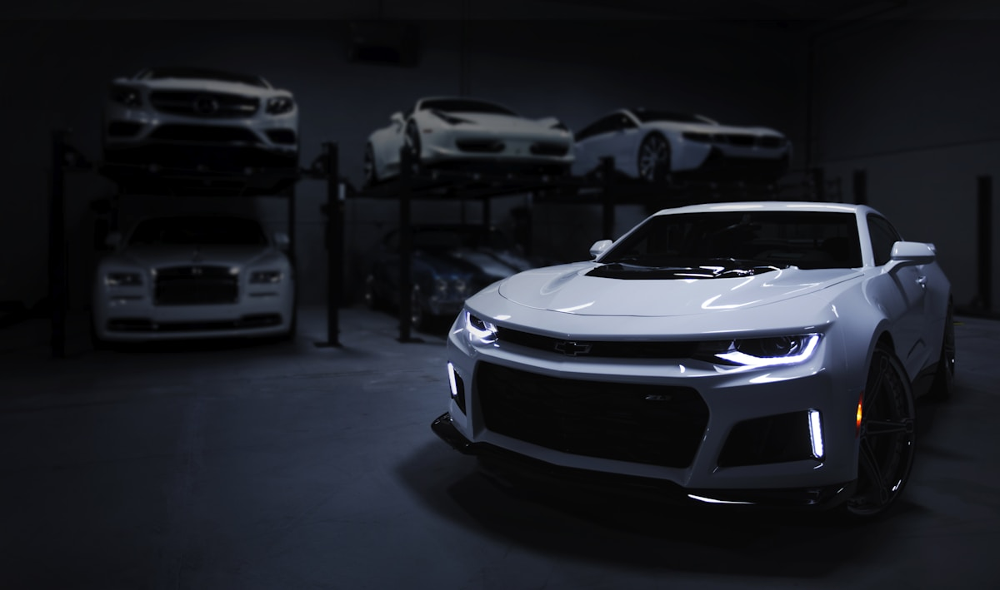

# Native RHD vs Converted LHD: The Sourcing Decision That Affects Warranty, Safety, and Resale

**Category:** Sourcing Intelligence  
**Date:** April 20, 2026  
**Read Time:** 6 min  
**Tag:** RHD · Left Hand Drive · Sourcing · BYD · Geely

---

*Right-hand drive compliance is not just a legal requirement — it is a sourcing decision with direct implications for warranty validity, crash safety performance, and resale value in Kenya, Tanzania, and Southern Africa.*

---

## Overview

Africa's major vehicle markets divide cleanly on steering configuration. Ethiopia, Nigeria, Egypt, Morocco, and most of West Africa drive on the right — **left-hand drive (LHD)** vehicles are required. Kenya, Tanzania, Uganda, South Africa, Mozambique, Zimbabwe, and most of Southern and East Africa drive on the left — **right-hand drive (RHD)** vehicles are required.

For dealers sourcing Chinese EVs, this split matters in a way it did not for Japanese used vehicle sourcing. Japan produces the majority of its vehicles in RHD, making compliant sourcing straightforward. China produces the overwhelming majority of its vehicles in LHD — only a subset of models have factory RHD variants.

The risk: a growing market of converted vehicles, where LHD Chinese EVs have their steering systems relocated post-production to create RHD units for sale in East and Southern Africa. The conversion may look acceptable and may even pass registration inspection — but it carries consequences that dealers and their buyers will eventually face.

---

## Why the LHD-to-RHD Conversion Exists

Chinese EV manufacturers design and produce primarily for the domestic Chinese market, which is LHD. For export, OEMs with significant RHD market ambitions — BYD, Geely, SAIC (MG), GWM — invest in native RHD production tooling for specific models. This is expensive and is only done for models with confirmed volume in RHD markets.

For models without native RHD production — which is the majority of the Chinese EV catalogue — export to RHD markets requires conversion. Conversion businesses operate across several Chinese cities and in receiving markets (South Africa, Kenya, UAE) that then re-export to the continent.

---

*Native RHD production means the vehicle was engineered and assembled as a right-hand drive unit from the factory floor — airbag positioning, wiper sweep, instrument cluster, and crash safety structure all reflect the correct configuration.*

---

## What a Conversion Changes — and What It Doesn't

A professional steering conversion relocates the steering rack, column, and wheel to the right side. It adjusts the instrument cluster mounting and sometimes the HVAC controls. What it typically does not change:

**Wiper sweep** — LHD wiper systems sweep from driver's right to passenger's left. In an RHD conversion, the driver's primary sightline is typically under-swept, reducing wet-weather visibility.

**Airbag positioning** — Airbag trigger sensors and deployment angles are calibrated for the structural zones where the driver and front passenger sit. In a converted vehicle, the airbag system has not been reengineered — the passenger side deployment remains calibrated for LHD impact dynamics.

**Crash safety structure** — Crumple zones and A-pillar reinforcement are designed asymmetrically based on the expected position of the driver. A conversion does not alter the structural steel — it puts the driver on the weaker side of a structure not designed for that configuration.

**Wiring and loom** — Converted vehicles often have non-standard wiring harness routing on the steering side, creating maintenance complexity that becomes evident during any significant electrical repair.

---

*The difference between a factory RHD unit and a converted one is not visible from the outside. It shows up in the wiper pattern, the airbag behaviour in a crash, and the warranty validity.*

---

## The Warranty Implication

Every major Chinese OEM's warranty policy includes a clause voiding the warranty for vehicles that have undergone post-production structural or steering system modification. BYD, Geely, SAIC, Chery, and GWM all include this language.

In practice: if a converted vehicle requires a warranty claim for any reason touching the steering system, electrical system, or occupant safety components — the OEM's warranty does not apply. In markets where official OEM service networks are thin or absent, this may not seem immediately relevant. But as Chinese OEMs expand African dealer networks, the gap between warranted and non-warranted vehicles will become commercially significant.

---

## Which Models Have Confirmed Factory RHD Production

The following Chinese EV models have confirmed native RHD production as of mid-2026:

| Brand | Model | RHD Markets | Notes |
|-------|-------|-------------|-------|
| BYD | Atto 3 (Yuan Plus) | South Africa, Australia, UK | Highest-volume Chinese EV in RHD markets |
| BYD | Seal | South Africa, Australia | Sedan; RHD since 2023 |
| BYD | Dolphin | South Africa, Australia, Thailand | RHD confirmed 2024 |
| BYD | Seagull | LHD only | No RHD variant as of mid-2026 |
| BYD | Shark 6 | South Africa, Kenya | PHEV pickup; RHD from launch |
| Geely | Galaxy E8 | Australia, UK (confirmed 2026) | RHD announced at Beijing 2026 |
| GWM | Ora 07 | South Africa | RHD native; small volume |
| SAIC (MG) | MG4 | South Africa, UK, Australia | Full RHD production run |
| SAIC (MG) | ZS EV | South Africa, UK | RHD native; established model |
| Jetour | Dashing | South Africa | PHEV crossover; RHD |

**Key finding**: The BYD Seagull — the most price-competitive Chinese BEV generating significant African importer interest — does not have a factory RHD variant as of mid-2026. Any Seagull being sold into Kenya, Tanzania, or South Africa is converted. For those markets specifically, this is a material sourcing risk to communicate to buyers.

---

## The Practical Decision Framework

For dealers sourcing into LHD markets (Ethiopia, Nigeria, West Africa): the entire Chinese EV catalogue is available in its native form. No conversion risk applies.

For dealers sourcing into RHD markets (Kenya, Tanzania, South Africa, East African interior landlocked states): apply this filter before any sourcing commitment:

1. **Confirm whether the specific model has factory RHD production.** Manufacturer websites, OEM regional export offices, and VIN-level production records are the reliable sources. Trader assurances are not.

2. **Request production documentation confirming RHD configuration.** For BYD models, this is available through the South Africa distribution office. For MG, through SAIC's regional export desk.

3. **For converted vehicles, factor in the warranty void.** Price accordingly — a converted vehicle should trade at a discount to a native RHD equivalent, not at parity.

4. **For fleet buyers**, native RHD is non-negotiable. Insurance providers in Kenya and South Africa are increasingly scrutinising conversion documentation, and some are excluding converted EV coverage from commercial fleet policies.

---

## Sources

- BYD South Africa — official model specifications and RHD confirmation (2025–2026)
- GWM South Africa — Ora 07 product documentation (2025)
- SAIC (MG) — MG4 and ZS EV production specification sheets (RHD variants, 2025)
- Geely Global — Galaxy E8 RHD announcement, Beijing Auto Show 2026
- African Insurance Institute — fleet vehicle compliance guidelines (Kenya, South Africa)
- CarNewsChina — *"Which Chinese EVs are available in right-hand drive?"* (2025)

---

*Published by Evexport Intelligence Desk · April 2026*
